<h1 align="center">Model Supply Chain Scanner</h1>

<p align="center">
  <em>A static scanner that finds code execution, file access and malformed structure in machine learning model files before they are loaded, without importing or running anything from them.</em>
</p>

<p align="center">
  <a href="https://github.com/adeoluo/model-supply-chain-scanner/actions/workflows/ci.yml"></a>
  <a href="https://github.com/adeoluo/model-supply-chain-scanner/releases"></a>
  
  
  <a href="LICENSE"></a>
</p>

---

## Motivation

Loading a model is often running code. `torch.load` with `weights_only=False`, `pickle`,
`joblib`, `np.load(allow_pickle=True)`, Keras Lambda layers, TensorFlow `PyFunc` ops and
unsandboxed chat templates all execute instructions that the file supplies, and ONNX external
data or malformed GGUF and safetensors headers can make a loader read outside the model or past
its buffers. Model hubs host millions of these files, and the scanners in use cover different
subsets of the formats.

`msscan` reads every format in one pass without importing anything from the file. A symbolic
pickle virtual machine executes opcodes over an abstract stack and records which globals are
imported and which are called; format analyzers cover PyTorch zip and legacy checkpoints,
joblib, NumPy, Keras `.keras`/HDF5/`keras_metadata.pb`, TensorFlow SavedModel, ONNX, GGUF and
safetensors. It ships as a Rust binary with text, JSON and SARIF output, an HTTP service, a
GitHub Action and a Python package that calls the same Rust core.

## Architecture

<p align="center">
  
</p>

<sub>Legend: amber = entry points and external systems, indigo = core logic, green = data and state, blue = validation and control, grey = observability and outputs.</sub>

The CLI, the HTTP service and the Python package hand paths or bytes to the same Rust library.
Files are memory-mapped and identified by content (the extension is only used to report
mismatches); containers such as PyTorch zips, `.npz`, `.keras` archives and compressed streams
are opened with size limits and their members scanned recursively. Pickles go through the
symbolic VM and the global allowlist and denylist; Keras, TensorFlow and ONNX graphs, GGUF and
safetensors headers and chat templates have their own analyzers. Findings carry a rule id,
severity and location, and a noisy-or score turns them into a verdict for text, JSON or SARIF
reports and Prometheus metrics. Details are in [`docs/ARCHITECTURE.md`](docs/ARCHITECTURE.md),
the rules in [`docs/RULES.md`](docs/RULES.md) and the decisions in [`docs/adr/`](docs/adr/).

## Results

All numbers come from runs on an Apple M1 (8 cores, 8 GB) with msscan 0.1.0, picklescan 1.0.5,
modelscan 0.8.8 and fickling 0.1.13, each at its default settings through its Python API. A
file counts as flagged by msscan when a finding reaches `high` (the CLI's default `--fail-on`);
picklescan when it reports an infected file; modelscan when it reports any issue; fickling when
`scan_file` rates it above `LIKELY_SAFE`. Intervals are 95% Wilson intervals.

### Inert malicious corpus (194 files, every technique)

[`benchmarks/corpus/generate.py`](benchmarks/corpus/generate.py) writes 116 malicious files
covering 77 techniques in 11 format families and 78 benign files written by the real libraries
(PyTorch, scikit-learn, joblib, NumPy, Keras, ONNX, safetensors). Every payload is inert (it
prints a canary, returns `os.getcwd()` or names a file that does not exist).
[`validate.py`](benchmarks/corpus/validate.py) loaded each file with its real loader in a
subprocess: all 101 malicious files with a Python loader ran their payload or were rejected, and
all 72 benign files loaded. Raw results:
[`benchmarks/results/synthetic.md`](benchmarks/results/synthetic.md).

| Tool | Malicious detected (116) | Benign flagged (78) | Files not scanned or with errors |
|---|---:|---:|---:|
| **msscan** (high) | **114 = 0.983 (0.939 to 0.995)** | **0 = 0.000 (0.000 to 0.047)** | 0 |
| msscan (medium) | 115 = 0.991 (0.953 to 0.998) | 0 = 0.000 (0.000 to 0.047) | 0 |
| picklescan | 69 = 0.595 (0.504 to 0.680) | 0 = 0.000 (0.000 to 0.047) | 10 |
| picklescan `--strict` | 77 = 0.664 (0.574 to 0.743) | 22 = 0.282 (0.194 to 0.390) | 10 |
| modelscan | 40 = 0.345 (0.265 to 0.435) | 0 = 0.000 (0.000 to 0.047) | 90 |
| fickling | 73 = 0.629 (0.539 to 0.712) | 31 = 0.397 (0.296 to 0.508) | 93 |
| fickling (overtly malicious only) | 69 = 0.595 (0.504 to 0.680) | 5 = 0.064 (0.028 to 0.141) | 93 |

On the 73 plain pickle and PyTorch payloads the tools are close (msscan 71/73, picklescan
`--strict` 72/73, fickling 72/73); the gap comes from formats the other tools do not read
(GGUF templates, Keras configs, SavedModel ops, ONNX paths, safetensors headers) and from
compressed joblib streams. msscan misses two of the three "hard" pickles, which call functions
outside its denylist on purpose (it reports one of them at medium); picklescan `--strict` and
fickling catch all three because they flag every unknown global, which is also why they flag
28% and 40% of the benign files. The corpus was written by the author of the scanner, so it is
a regression gate and a map of coverage, not an estimate of recall on unknown attacks.

### Hugging Face Hub corpus (7,607 real files from 2,888 repositories)

[`benchmarks/hf/collect.py`](benchmarks/hf/collect.py) fetched, without a token and with HTTP
range requests, what a scanner reads: the pickle members of PyTorch zip checkpoints rebuilt into
stub archives, `.keras` configs, safetensors and GGUF headers, and whole files up to 20 MB for
other formats (2.5 GB stored in total). The files are 2,510 Hugging Face JSON configs, 2,462
safetensors headers, 1,534 pickle-family files (PyTorch, pickle, joblib, NumPy), 471 Keras
archives, 391 GGUF headers and 239 ONNX, HDF5 and SavedModel files. There is no ground truth in
the wild, so [`review.py`](benchmarks/hf/review.py) labels each file from what it contains,
never from a tool's verdict:

- **payload**: reaches a system or eval primitive on load (pickle calls into `os`, `posix`,
  `nt`, `subprocess`, `sys`, `requests` or `builtins.eval`; a Keras config naming such a module;
  a GGUF template reaching Python internals; an ONNX path leaving the model directory);
- **security-test**: other files in repositories that describe themselves as security test
  material (crafted malformed files and benign baselines);
- **code-by-design**: loading runs code that is not plain data (Keras Lambda layers or classes
  from outside Keras, pickles calling modules outside the known libraries, TorchScript,
  Hugging Face configs asking for remote code);
- **nonstandard**: breaks the current format specification but was written by legitimate tools
  (five-dimensional GGUF tensors, GGUF type ids that llama.cpp does not define, safetensors data
  sections with uncovered bytes);
- **benign**: everything else.

The other tools receive the pickle-family, Keras, ONNX, HDF5 and SavedModel files stored in
full (2,244 files); safetensors and GGUF headers and JSON configs are formats they do not read.

| Files | msscan (high) | picklescan | picklescan `--strict` | modelscan | fickling (overtly malicious) | fickling |
|---|---:|---:|---:|---:|---:|---:|
| payload (17; 16 for the others) | **17/17** | 7/16 | 7/16 | 5/16 | 7/16 | 7/16 |
| pickle-family payloads (10) | **10/10** | 7/10 | 7/10 | 5/10 | 7/10 | 7/10 |
| security-test (27; 20) | 7/27 | 0/20 | 0/20 | 2/20 | 0/20 | 0/20 |
| no attack: all formats (7,563; 2,208) | 31 = 0.004 (0.003 to 0.006) | **1 = 0.000 (0.000 to 0.003)** | 573 = 0.260 | **1 = 0.000 (0.000 to 0.003)** | 145 = 0.066 | 1,226 = 0.555 |
| no attack: pickle family (1,520) | 8 = 0.005 (0.003 to 0.010) | **1 = 0.001 (0.000 to 0.004)** | 573 = 0.377 | **1 = 0.001 (0.000 to 0.004)** | 145 = 0.095 | 1,226 = 0.807 |

msscan found all 17 payloads, including three zlib-compressed joblib and pickle files that call
`builtins.eval` (none of the other tools decompresses them), Keras configs that import
`os.system` or `builtins.eval`, ONNX traversal to `/etc/passwd` and a GGUF template that reaches
`os.system`. picklescan and modelscan raise the fewest alerts on files without an attack (one
each). msscan's 31 alerts there are 11 Keras Lambda layers, 9 GGUF files with 5-D tensors or
unknown type ids, 7 pickles calling `dill` internals or `getattr` or setting dunder attributes,
3 safetensors headers (two with uncovered bytes in the data section, one macOS metadata file
named `.safetensors`) and a TensorFlow.js weight shard read as a safetensors header; it reports
a further 111 such files at medium. The labels rely on msscan's parsers for structure (imports,
Lambda layers, header fields), so a construct those parsers miss is invisible to the labels too;
this is why the security-test group is reported on its own. Of its 27 files msscan flags 7 at
high (three crafted GGUF structures, a safetensors polyglot and three Lambda layers) and one more at medium (a
NumPy shape needing 80 GB); the others are benign baselines, weight backdoors (out of scope for a
static scanner), an ONNX docstring injection, safetensors with odd tensor names, and a Keras
zip-slip member and a decompression bomb that the headers-only collection did not fetch.
Raw rows (pseudonymous ids, no repository names):
[`hf_corpus.json`](benchmarks/results/hf_corpus.json), labels and tables:
[`hf_review.md`](benchmarks/results/hf_review.md).

### Speed and memory

[`benchmarks/speed.py`](benchmarks/speed.py) runs each tool on each file three times in a fresh
process under `/usr/bin/time -l` and reports the median wall time and peak resident memory
(including interpreter start-up and imports for the Python tools). The checkpoints are real Hub
files (Helsinki-NLP opus-mt-en-de and opus-mt-en-fr PyTorch zips, Qwen2.5-0.5B-Instruct
safetensors); the plain-data pickle (31 MB, about 3.35 million list items, no globals)
is generated with seed 0. The machine was shared with other work, so individual runs of one tool on one
file differ by up to 3.4 times; raw runs are in [`speed.json`](benchmarks/results/speed.json).

| Tool | opus-mt-en-de `.bin` (284 MB) | opus-mt-en-fr `.bin` (287 MB) | Qwen2.5-0.5B `.safetensors` (942 MB) | plain-data pickle (31 MB) |
|---|---:|---:|---:|---:|
| **msscan** (binary) | < 0.01 s, 4 MB | 0.01 s, 4 MB | 0.01 s, 3 MB | 0.58 s, 239 MB |
| msscan (Python package) | 0.33 s, 20 MB | 0.18 s, 21 MB | 0.10 s, 21 MB | 0.30 s, 258 MB |
| picklescan | 0.15 s, 26 MB | 0.21 s, 26 MB | 0.16 s, 24 MB | 24 s, 688 MB |
| modelscan | 0.44 s, 39 MB | 0.47 s, 39 MB | 0.43 s, 39 MB | 27 s, 579 MB |
| fickling | 6.53 s, 251 MB | 6.01 s, 286 MB | 6.72 s, 280 MB | 190 s, 828 MB |

msscan memory-maps the file and reads only the pickle members of a zip or the header of a
safetensors file, so its cost does not grow with the weights. On the plain-data pickle, which
every tool must walk opcode by opcode, msscan takes 0.3 to 0.6 s against 24 s (picklescan), 27 s
(modelscan) and 190 s (fickling). On the Hub corpus, msscan scanned all 7,607 files in
9.8 s in one process; on the 2,244 files the other tools received, picklescan took
75.3 s, modelscan 33.4 s and fickling 683.4 s.

## Quickstart

```bash
git clone https://github.com/adeoluo/model-supply-chain-scanner && cd model-supply-chain-scanner
cargo build --release -p msscan            # or download a binary from the releases page
./target/release/msscan scan tests/fixtures
```

Python (the package compiles the Rust core with maturin):

```bash
uv sync
uv run python -c "import msscan; print(msscan.scan_file('tests/fixtures/malicious_torch.pt').summary())"
```

## Usage

### Command line

```bash
msscan scan model.pt models/                # text report; exit status 1 at high or above
msscan scan -f sarif -o report.sarif models/ --fail-on critical
msscan scan -f json --hash --min-severity info model.gguf
msscan rules --format markdown              # the 44 rules
python -m msscan scan models/               # the same scan from the Python package
```

Exit status: 0 when nothing reaches `--fail-on`, 1 when something does, 2 on usage or I/O
errors. Formats are detected by content, so renamed files are still scanned.

### Library

```python
import msscan

report = msscan.scan_file("pytorch_model.bin")
print(report.verdict, report.risk_score)            # "clean", "suspicious", "unsafe" or "malicious"
for f in report.findings:
    print(f.severity, f.rule, f.message, f.location)

msscan.scan_bytes(header_bytes, "model.safetensors", declared_size=total_size)  # headers only
print(msscan.render(msscan.scan_path("models/"), "sarif"))
```

### HTTP service

```bash
msscan serve --addr 127.0.0.1:8080
curl --data-binary @model.pt 'localhost:8080/v1/scan?name=model.pt'
curl localhost:8080/health; curl localhost:8080/ready; curl localhost:8080/metrics
```

`docker compose up --build` runs the same service in a container.

### GitHub Action

```yaml
- uses: adeoluo/model-supply-chain-scanner@v0.1.0
  with:
    path: models/
    output: msscan.sarif
    fail-on: high
- uses: github/codeql-action/upload-sarif@v4
  with:
    sarif_file: msscan.sarif
```

### Demos

Recorded from real runs with [vhs](https://github.com/charmbracelet/vhs); each tape is in `docs/demo/`.

Scanning the bundled inert fixtures: findings, locations and verdicts.

<p align="center">
  
</p>

A SARIF report for code scanning, read with jq.

<p align="center">
  
</p>

The HTTP service scanning an uploaded checkpoint, and its metrics.

<p align="center">
  
</p>

The Python API on a `__setstate__` injection, a rot13 dynamic import and a clean state dict.

<p align="center">
  
</p>

## Design decisions

- **One Rust core for every interface** ([ADR 0002](docs/adr/0002-rust-core-with-python-bindings.md)):
  the CLI, service and Python package share one implementation, so the benchmarks measure what
  users run; a small Python reference analyzer exists only for parity tests.
- **Symbolic execution of pickles** ([ADR 0003](docs/adr/0003-symbolic-pickle-vm.md)): every
  opcode is applied to an abstract stack, so a global is reported as called or only imported,
  dynamic imports (`STACK_GLOBAL` names built at load time) and `BUILD` writes to dunder
  attributes are caught, and nested `pickle.loads` payloads are analyzed recursively. Globals are
  tiered safe, library, unknown or dangerous.
- **Severities, verdicts and a noisy-or score** ([ADR 0004](docs/adr/0004-risk-scoring-and-verdicts.md)):
  findings keep their own severity; the verdict and score summarize them for gates.
- **Keras configs from raw bytes** ([ADR 0005](docs/adr/0005-configs-from-raw-bytes.md)): HDF5
  and `keras_metadata.pb` files are searched for embedded JSON configs instead of parsing HDF5,
  which keeps the binary free of native HDF5 libraries.
- **A Hub corpus from headers, published without names** ([ADR 0006](docs/adr/0006-hub-corpus-headers-only.md)):
  only the bytes a scanner reads were fetched, and results carry salted pseudonyms.

## Testing

```bash
make lint        # cargo fmt --check, clippy -D warnings, ruff format --check, ruff check
make type        # mypy src
make test        # cargo test (unit, property and CLI tests) and pytest
make coverage    # Rust line coverage gate 85%, Python coverage gate 80%
```

97 Rust tests (96% line coverage with `cargo llvm-cov`) and 29 Python tests (92% coverage):

- **Pickle VM** (`pickle/tests.rs`): every opcode family across protocols 0 to 5, `GLOBAL`,
  `STACK_GLOBAL` with names computed at load time (`_codecs.encode` rot13), `INST`/`OBJ`/`NEWOBJ`,
  `BUILD` writes to dunder attributes and `__setstate__`, memo tricks, nested `pickle.loads`
  payloads, joblib array skipping, limits, and property tests that random bytes never panic.
- **Formats** (`scan/tests.rs` and one module per format): zip traversal and header mismatch,
  encrypted members, decompression bombs, legacy PyTorch, NumPy object arrays, Keras Lambda and
  module rules, SavedModel ops, ONNX external data in subgraphs, GGUF counts, lengths, types,
  bounds and chat templates, safetensors offsets and headers-only prefixes, plus a property test
  over ten formats with random tails.
- **Policy**: tier assignments for denylisted modules, dotted attribute paths and library
  namespaces (including the torch.distributed split).
- **Parity** (`tests/test_parity.py`): the Rust VM reports the same imports and calls as the
  Python reference analyzer on hypothesis-generated objects for every protocol, on optimized
  pickles and on hand-written tricks.
- **Interfaces**: CLI exit codes and the three report formats (Rust and Python), the Python API,
  the HTTP service (`/health`, `/ready`, `/metrics`, `/v1/scan`), every bundled fixture's verdict,
  and the benchmark scoring and Hub labeling code.

CI runs format, lint, type checks and both coverage gates on Python 3.12, 3.13, 3.14 and 3.15, the Rust
tests, the release binary on the fixtures with SARIF output, this repository's GitHub Action, and
a Docker build probed over HTTP. CodeQL runs on pushes to main and weekly.

## Responsible AI

- **Threat model:** [`docs/THREAT_MODEL.md`](docs/THREAT_MODEL.md) lists the techniques, the
  rules that cover them and the attacks that are out of scope.
- **Standards:** the [threat model](docs/THREAT_MODEL.md#standards-mapping) maps every rule
  family to LLM04:2026 Supply Chain in the OWASP Top 10 for LLM Applications 2026 and to MITRE
  ATLAS v2026.10 (for example AML.T0011.000 User Execution: Unsafe AI Artifacts,
  AML.T0018.002 Manipulate AI Model: Embed Malware and AML.T0076 Corrupt AI Model).
- **Data card:** [`docs/DATA_CARD.md`](docs/DATA_CARD.md) describes both corpora.
- **Inert fixtures:** every malicious file in the repository and the generated corpus calls a
  harmless function (`print`, `os.getcwd`) or names a file that does not exist; nothing deletes,
  writes outside the corpus directory or opens a connection.
- **Hub data:** files were read for security analysis and not redistributed; repository names
  stay outside the repository and no repository owner was contacted.

## Limitations

- A static scanner sees only what the file declares. Pickles that reach dangerous behaviour
  through functions outside the denylist (the "hard" tier) are reported at medium or not at all,
  and attacks that live in the weights (backdoors, poisoned behaviour) are out of scope.
- The allowlist and library tiers trade alerts for recall: a malicious function inside a trusted
  library namespace would be rated as library code.
- Headers-only scanning of the Hub corpus skips archive members other than pickles and configs,
  so zip-slip names and decompression bombs in large `.keras` archives were not measured there.
- Keras resolution rules differ across versions; MS505 assumes a loader might import the
  third-party module named in the config.
- GGUF validation follows llama.cpp's current limits, so newer tensor types and five-dimensional
  tensors used by other tools are reported as malformed.

## Roadmap

- [ ] Opt-in reachability analysis for library calls, to separate `print` from data
      reconstruction without listing every function.
- [ ] Streaming scans of remote files over HTTP range requests from the CLI.
- [ ] More formats: TensorFlow Lite flatbuffers, Core ML, PaddlePaddle.

## License

Released under the [MIT License](LICENSE).
