<h1 align="center">Model Supply Chain Scanner</h1>

<p align="center">
  <em>A static scanner that finds code execution, file access and malformed structure in machine learning model files before they are loaded, without importing or running anything from them.</em>
</p>

<p align="center">
  <a href="https://github.com/adeoluo/model-supply-chain-scanner/actions/workflows/ci.yml"></a>
  <a href="https://github.com/adeoluo/model-supply-chain-scanner/releases"></a>
  
  
  <a href="LICENSE"></a>
</p>

---

> **Evidence level: publicly benchmarked, with limits.** Compared with picklescan, modelscan, fickling and ModelAudit on the test files those projects publish, on a corpus written by the scanner's author, and on two samples of public Hugging Face files (12,573 files, no ground-truth labels), the second scanned with the engine frozen before any tuning. Bypasses reported by outside reviewers are listed with their fixes below. Not independently reproduced and not used in production. [What the levels mean](https://github.com/adeoluo#evidence-levels).

## Highlights

AI model files can hide code that runs the moment you load them. This tool reads a model file
**without loading it** and tells you whether it would run something dangerous.

- **It scores highest on the other scanners' own test files.** Four other scanner projects
  publish 181 test files: 144 dangerous and 37 safe. msscan catches 141 of the 144 and raises
  no false alarm on the 37. ModelAudit catches 139 with 4 false alarms, picklescan 113 with
  none, fickling 107 with 6, modelscan 48 with none. Version 0.1 of msscan caught 117.
- **It caught every dangerous file in two real-world samples.** In 12,573 files from 4,727
  public Hugging Face repositories, 24 would run a command, call `eval` or read a file
  outside the model when loaded. msscan flags all 24. Of the 22 that the other tools can
  read, ModelAudit flags 19, picklescan and fickling 12, modelscan 7.
- **It rarely cries wolf.** In the first sample it raises 6 high alerts on 8,495 files that
  carry no attack (version 0.1 raised 31 on 7,563). Two of the six pickle whole functions,
  three hide a shell command in a text string and one calls `print`. On the 1,694 pickle
  files that every tool read, msscan raises 3, picklescan and modelscan 1 each, and
  ModelAudit rates 275 critical.
- **It was tested on files it had never seen, and the bad news is published.** A second
  sample of the newest repositories was scanned with the engine frozen. It caught the 3
  dangerous pickles, raised 14 false alarms on 4,023 clean files (picklescan raised 3) and
  rated one proof-of-concept attack file low. Every one of those became a fix: after them it is 5 of 5
  dangerous files and 1 alert, but that second number is no longer an unseen test.
- **It reads more formats in one pass:** pickle, PyTorch, joblib, NumPy, Keras, ONNX,
  TensorFlow SavedModel, GGUF, safetensors, zip, 7z and tar archives, YAML and JSON configs
  and chat templates. It also reads the code hidden inside Keras Lambda layers and inside
  text strings, without running it.
- **It is fast and small.** A 284 MB model takes under 0.01 seconds and 4 MB of memory. On
  a 31 MB pickle it takes 0.16 seconds where the others take 6, 6, 16 and 37 seconds.

**What it has not done:**

- **Found an attack nobody knew about.** Hugging Face's own scanners already flag 18 of the
  24 dangerous files. The other 6 sit in repositories that are scanner tests by their
  name, their description or their owner's other repositories.
- **Beaten ModelAudit by a margin that means something.** 141 against 139 out of 144 is two
  files. msscan's three misses are ModelAudit test files that only name a custom Keras
  class and carry no code, which msscan reports at low on purpose.
- **Stayed quieter than picklescan on unseen files.** Before the fixes, 14 alerts against 3.
- **Survived outside review untouched.** Three reviewers got files past version 0.1; every
  gap is fixed and [listed below](#bypasses-found-by-outside-reviewers).

## Motivation

Loading a model is often running code. `torch.load` with `weights_only=False`, `pickle`,
`joblib`, `np.load(allow_pickle=True)`, Keras Lambda layers, TensorFlow `PyFunc` ops and
unsandboxed chat templates all execute instructions that the file supplies, and ONNX external
data or malformed GGUF and safetensors headers can make a loader read outside the model or past
its buffers. A config can name a file on the loading machine, and a repository can carry a
symbolic link that points out of it. Model hubs host millions of these files, and the
scanners in use cover different subsets of the formats.

`msscan` reads every format in one pass without importing anything from the file. A symbolic
pickle virtual machine executes opcodes over an abstract stack and records which globals are
imported and which are called; format analyzers cover PyTorch zip and legacy checkpoints,
joblib, NumPy, Keras `.keras`/HDF5/`keras_metadata.pb`, TensorFlow SavedModel, ONNX, GGUF,
safetensors, zip, 7z and tar archives, YAML and JSON configs and chat templates. It ships as a Rust binary with text, JSON and SARIF output, an HTTP service, a
GitHub Action and a Python package that calls the same Rust core.

## Architecture

<p align="center">
  
</p>

<sub>Legend: amber = entry points and external systems, indigo = core logic, green = data and state, blue = validation and control, grey = observability and outputs.</sub>

The CLI, the HTTP service and the Python package hand paths or bytes to the same Rust library.
Files are memory-mapped and identified by content (the extension is only used to report
mismatches); containers such as PyTorch zips, `.npz`, `.keras` archives and compressed streams
are opened with size limits and their members scanned recursively, as are 7z and tar
archives. Pickles go through the symbolic VM and three tiers of rules for globals (allowlist,
denylist, and the shape of a call), and their string constants are checked for a second
pickle or code hidden inside. Keras, TensorFlow and ONNX graphs, GGUF and safetensors
headers, configs and chat templates have their own analyzers; Keras Lambda bytecode is read
without running it. Symbolic links are followed inside the scanned folder and reported when
they leave it. Findings carry a rule id,
severity and location, and a noisy-or score turns them into a verdict for text, JSON or SARIF
reports and Prometheus metrics. Details are in [`docs/ARCHITECTURE.md`](docs/ARCHITECTURE.md),
the rules in [`docs/RULES.md`](docs/RULES.md) and the decisions in [`docs/adr/`](docs/adr/).

## Results

All numbers come from runs on an Apple M1 (8 cores, 8 GB) with msscan 0.2.0, picklescan
1.0.5, modelscan 0.8.8, fickling 0.1.13 and ModelAudit 0.2.58, each at its default settings
through its Python API. A file counts as flagged by msscan when a finding reaches `high` (the
CLI's default `--fail-on`); picklescan when it reports an infected file; modelscan when it
reports any issue; fickling when `scan_file` rates it above `LIKELY_SAFE`; ModelAudit when it
reports an issue at warning or critical, which is what makes its CLI exit with status 1 (a
second row counts critical issues only). Intervals are 95% Wilson intervals.

There are four tests, in order of how much they prove:

| Test | Who wrote the files | Were msscan's rules tuned on them? |
|---|---|---|
| 1. Other projects' test files (181) | the four other scanner projects | yes, version 0.2 was built against them |
| 2. Authored corpus (243) | the author of msscan | yes |
| 3. Hugging Face, first sample (8,541) | the public | yes |
| 4. Hugging Face, second sample (4,032) | the public | **no** for the frozen run, yes after it |

### 1. Test files written by the other scanner projects (181 files)

[`benchmarks/third_party.py`](benchmarks/third_party.py) copies the files that picklescan,
ModelAudit, modelscan and fickling keep in their own repositories to test themselves: 144
that their tests say must be flagged and 37 that their tests say must pass. A label is taken
only from what the upstream test asserts, never from a tool's verdict here. Many of the
malicious files are the proof-of-concept files of published scanner-bypass advisories.
`make third-party` clones the four repositories and reruns everything; raw results:
[`third_party.md`](benchmarks/results/third_party.md).

| Tool | Malicious detected (144) | Benign flagged (37) | Files not scanned or with errors |
|---|---:|---:|---:|
| **msscan** (high) | **141 = 0.979 (0.941 to 0.993)** | **0 = 0.000 (0.000 to 0.094)** | 0 |
| msscan (medium) | 141 = 0.979 (0.941 to 0.993) | 7 = 0.189 (0.095 to 0.342) | 0 |
| ModelAudit | 139 = 0.965 (0.921 to 0.985) | 4 = 0.108 (0.043 to 0.247) | 7 |
| ModelAudit (critical only) | 134 = 0.931 (0.877 to 0.962) | 1 = 0.027 (0.005 to 0.138) | 7 |
| picklescan | 113 = 0.785 (0.711 to 0.844) | 0 = 0.000 (0.000 to 0.094) | 6 |
| picklescan `--strict` | 114 = 0.792 (0.718 to 0.850) | 2 = 0.054 (0.015 to 0.177) | 6 |
| fickling | 107 = 0.743 (0.666 to 0.807) | 6 = 0.162 (0.077 to 0.311) | 51 |
| fickling (overtly malicious only) | 96 = 0.667 (0.586 to 0.738) | 0 = 0.000 (0.000 to 0.094) | 51 |
| modelscan | 48 = 0.333 (0.262 to 0.414) | 0 = 0.000 (0.000 to 0.094) | 57 |

By source: on picklescan's 94 malicious files msscan and picklescan both catch 94, ModelAudit
89, fickling 88 and modelscan 28. On ModelAudit's 49, ModelAudit catches 49, msscan 46,
modelscan 19, picklescan and fickling 18.

**Read this for what it is.**

- The gap between msscan and ModelAudit is two files and the intervals overlap almost
  entirely. The honest summary is that both catch nearly everything here and msscan does it
  with no false alarm.
- Every malicious file msscan catches is caught by at least one other tool too. Nothing in
  this set is caught by msscan alone.
- msscan's three misses are ModelAudit files: Keras HDF5 models that name a custom layer,
  loss or metric and contain no code. Loading them needs the caller to supply that code, so
  msscan reports them at low (MS503) and that is a decision, not an oversight.
- ModelAudit's five misses are picklescan files: zip archives whose headers are altered so
  that a scanner and PyTorch read different members.
- Version 0.1.1 of msscan caught 117 of the 144. Of the 141 caught now, 21 are caught only
  by rules that are new in 0.2, and 20 of those rest on refusing calls by their shape
  ([ADR 0007](docs/adr/0007-refuse-calls-by-shape.md)). These files were the target while
  that work was done, so 141 is a fitted number.
- Two faults in this project's harness first made ModelAudit look worse (124 detected, 8
  false alarms). Its chat-template fixtures were scanned under file names it does not
  recognize, and its output was silenced in a way that changed its verdicts. Both are fixed,
  and the figures above are the ones after the fix.

### 2. Authored corpus (243 files, 100 techniques)

[`benchmarks/corpus/generate.py`](benchmarks/corpus/generate.py) writes 142 malicious files
covering 100 techniques in 15 format families and 101 benign files, most of them written by
the real libraries (PyTorch, scikit-learn, joblib, NumPy, Keras, ONNX, safetensors). Every
payload is inert (it prints a canary, returns `os.getcwd()` or names a file that does not
exist). [`validate.py`](benchmarks/corpus/validate.py) loaded each file with its real loader
in a subprocess: all 106 malicious files with a Python loader ran their payload or were
rejected, and all 72 benign files with one loaded. Raw results:
[`synthetic.md`](benchmarks/results/synthetic.md).

| Tool | Malicious detected (142) | Benign flagged (101) | Files not scanned or with errors |
|---|---:|---:|---:|
| **msscan** (high) | **142 = 1.000 (0.974 to 1.000)** | **0 = 0.000 (0.000 to 0.037)** | 0 |
| msscan (medium) | 142 = 1.000 (0.974 to 1.000) | 6 = 0.059 (0.028 to 0.124) | 0 |
| ModelAudit | 128 = 0.901 (0.841 to 0.940) | 55 = 0.545 (0.448 to 0.638) | 18 |
| ModelAudit (critical only) | 103 = 0.725 (0.647 to 0.792) | 14 = 0.139 (0.084 to 0.219) | 18 |
| picklescan | 71 = 0.500 (0.419 to 0.581) | 3 = 0.030 (0.010 to 0.084) | 16 |
| picklescan `--strict` | 83 = 0.585 (0.502 to 0.662) | 26 = 0.257 (0.182 to 0.350) | 16 |
| fickling | 75 = 0.528 (0.446 to 0.608) | 36 = 0.356 (0.270 to 0.454) | 115 |
| fickling (overtly malicious only) | 71 = 0.500 (0.419 to 0.581) | 9 = 0.089 (0.048 to 0.161) | 115 |
| modelscan | 40 = 0.282 (0.214 to 0.361) | 0 = 0.000 (0.000 to 0.037) | 119 |

**Read the 142/142 for what it is.** The corpus was written by the author of the scanner, so
it is a regression gate and a map of coverage, not an estimate of recall on unknown attacks.
A new file is added each time something gets past the scanner, which is why it never misses
here. Eleven of these files are flagged by msscan alone (malformed GGUF and safetensors
headers, unsafe YAML and Hydra configs, a SavedModel file-listing op, checkpoint indexes
that point outside the model), and that also follows from who wrote them. The benign side
is more useful: it includes the shapes that were false alarms in the two Hugging Face
samples, and 39 of the 55 benign files ModelAudit flags are joblib and PyTorch checkpoints
written by the real libraries.

### 3. Hugging Face, first sample (8,541 real files from 2,789 repositories)

[`benchmarks/hf/collect.py`](benchmarks/hf/collect.py) fetched, without a token and with HTTP
range requests, what a scanner reads: the pickle members of PyTorch zip checkpoints rebuilt
into stub archives, `.keras` configs, safetensors and GGUF headers, and whole files up to
20 MB for other formats. The repositories are the listing drawn for version 0.1 (most
downloaded, most recently changed, most liked, and format filters). That version did not
keep the files, so they were fetched again on 2026-11-23 and kept (3.7 GB), which is why the
counts differ from the 7,607 files reported before. The files are 2,827 JSON configs, 2,587
safetensors headers, 1,710 pickle-family files (PyTorch, pickle, joblib, NumPy), 525 Keras
archives, 432 GGUF headers and 460 ONNX, HDF5 and SavedModel files. There is no ground truth
in the wild, so [`review.py`](benchmarks/hf/review.py) labels each file from what it
contains, never from a tool's verdict:

- **payload**: reaches a system or eval primitive on load (pickle calls into `os`, `posix`,
  `nt`, `subprocess`, `sys`, `requests` or `builtins.eval`; a Keras config naming such a
  module; a GGUF template reaching Python internals), or reaches a file outside the model
  (an ONNX external-data path, a checkpoint index, a Keras layer config or a stored link);
- **security-test**: other files in repositories that describe themselves as security test
  material (crafted malformed files and benign baselines);
- **code-by-design**: loading runs code that is not plain data (Keras Lambda layers or
  classes from outside Keras, pickles calling modules outside the known libraries,
  TorchScript, Hugging Face configs asking for remote code);
- **nonstandard**: breaks the current format specification but was written by legitimate
  tools (five-dimensional GGUF tensors, GGUF type ids that llama.cpp does not define,
  safetensors data sections with uncovered bytes, pickles that end early);
- **benign**: everything else.

The other tools receive the pickle-family, Keras, ONNX, HDF5 and SavedModel files stored in
full (2,695 files); safetensors and GGUF headers and JSON configs are formats they do not
read from a header.

| Files | msscan (high) | picklescan | picklescan `--strict` | modelscan | fickling (overtly malicious) | fickling | ModelAudit (critical) | ModelAudit |
|---|---:|---:|---:|---:|---:|---:|---:|---:|
| payload (19; 18 for the others) | **19/19** | 9/18 | 9/18 | 6/18 | 9/18 | 9/18 | 16/18 | 16/18 |
| pickle-family payloads (12) | **12/12** | 9/12 | 9/12 | 6/12 | 9/12 | 9/12 | **12/12** | **12/12** |
| security-test (27; 20) | 6/27 | 0/20 | 0/20 | 2/20 | 0/20 | 0/20 | 4/20 | 7/20 |
| no attack: all formats (8,495; 2,657) | 6 = 0.001 (0.000 to 0.002) | **1 = 0.000 (0.000 to 0.002)** | 634 = 0.239 | **1 = 0.000 (0.000 to 0.002)** | 170 = 0.064 | 1,358 = 0.511 | 357 = 0.134 | 1,606 = 0.604 |
| no attack: pickle family (1,694) | 3 = 0.002 (0.001 to 0.005) | **1 = 0.001 (0.000 to 0.003)** | 633 = 0.374 | **1 = 0.001 (0.000 to 0.003)** | 170 = 0.100 | 1,358 = 0.802 | 275 = 0.162 | 1,394 = 0.823 |

msscan flags all 19 payload files. ModelAudit flags every pickle-family one and misses two
Keras archives whose config imports a system module. picklescan, fickling and modelscan miss
the three zlib-compressed joblib and pickle files that call `builtins.eval`, the Keras
configs and the ONNX paths. picklescan and modelscan still raise the fewest alerts on files
without an attack: one each, against three for msscan on the same pickle files.

msscan's six high alerts on files without an attack are:

- two pickles that carry whole functions and classes serialized by `dill` (the code is in
  the file by design; Hugging Face's scanners flag both);
- three pickles named `.keras` that hold the text
  `lambda x: exec('import os; os.system(...)')` as a string. Loading them runs nothing; code
  that evaluates the string would. They sit in a repository of generated test files next to
  real payload files. ModelAudit flags them too; picklescan, modelscan and fickling pass
  them;
- one pickle that calls `builtins.print`, in a repository that also holds payload files
  (fickling flags it too).

Version 0.1.0 raised 31 high alerts on 7,563 such files. The difference is that Keras Lambda
layers are now read as bytecode and graded by what they name (the 9 here that are not test
material only do arithmetic and are medium), GGUF files with five-dimensional tensors or unknown type ids are low
(22 files), lookups such as `getattr(Class, "method")` are resolved, and a macOS metadata
file or a TensorFlow.js shard is no longer read as a broken safetensors header. msscan
reports a further 184 files at medium.

The labels rely on msscan's parsers for structure (imports, Lambda layers, header fields),
so a construct those parsers miss is invisible to the labels too, and the payload row counts
what the other tools miss, not what msscan misses. This is why the security-test group is
reported on its own: of its 27 files msscan flags 6 at high (crafted GGUF structures and
Lambda layers that import or evaluate) and 2 more at medium; the others are benign
baselines, weight backdoors (out of scope for a static scanner), an ONNX docstring
injection, safetensors with odd tensor names, and a Keras zip-slip member and a
decompression bomb that the headers-only collection did not fetch. Raw rows (pseudonymous
ids, no repository names): [`hf_corpus.json`](benchmarks/results/hf_corpus.json), labels and
tables: [`hf_review.md`](benchmarks/results/hf_review.md).

### 4. Hugging Face, second sample (4,032 files from 1,938 repositories, never tuned on)

Tests 1 to 3 measure files that shaped the rules. This one does not. `make hf-heldout` lists
the most recently created model repositories on the Hub, drops every repository of the
first sample, and fetches the same kinds of files plus YAML configs, chat templates and
archives (2.7 GB). **The engine was committed before the first scan of this sample**, and
that scan is published as measured
([`hf_heldout_frozen_review.md`](benchmarks/results/hf_heldout_frozen_review.md)). The
reasoning is in [ADR 0008](docs/adr/0008-held-out-sample-and-what-it-changed.md).

| Files | msscan (high), frozen | msscan (high), after fixes | picklescan | modelscan | fickling (overtly malicious) | ModelAudit (critical) | ModelAudit |
|---|---:|---:|---:|---:|---:|---:|---:|
| pickles that run a command or `eval` (3) | 3/3 | 3/3 | 3/3 | 1/3 | 3/3 | 3/3 | 3/3 |
| files that read outside the model (2; 1 for the others) | 1/2, as a broken header | 2/2 | 0/1 | 0/1 | 0/1 | 0/1 | 0/1 |
| no attack: all formats (4,023; 2,313) | 14 = 0.003 (0.002 to 0.006) | 1 = 0.000 (0.000 to 0.001) | **3 = 0.001 (0.000 to 0.004)** | **1 = 0.000 (0.000 to 0.002)** | 304 = 0.131 | 453 = 0.196 | 1,234 = 0.534 |
| no attack: pickle family (1,347) | 11 = 0.008 (0.005 to 0.015) | 1 = 0.001 (0.000 to 0.004) | **3 = 0.002 (0.001 to 0.007)** | **1 = 0.001 (0.000 to 0.003)** | 304 = 0.226 | 414 = 0.307 | 1,066 = 0.791 |

**What the frozen engine got wrong**, which is the result of this test:

- **14 false alarms, against 3 for picklescan and 1 for modelscan.** Eight were scikit-learn
  pipelines that store `functools.partial(check_array, ...)` inside a `FunctionTransformer`.
  One was a PyTorch Lightning checkpoint storing `partial(Adam, ...)`, one a pipeline
  storing `operator.methodcaller("__floordiv__", 3600)`, one a YAML config using
  `!!python/tuple`, and one an encoded Git LFS pointer saved under a `.safetensors` name.
  None of these twelve runs anything on load. The other two are a file that is still
  flagged (below) and the stored link (below), which the frozen run's own labels counted as
  a clean file. Two rules assumed that ordinary files do not store functions this way: the
  denylist entries for `operator.methodcaller` and for `functools.partial` (the second
  added after an outside review), and the call-shape rule that scores in test 1. That assumption held for
  the 8,541 files of the first sample and failed on the next 4,032.
- **One proof-of-concept attack rated low.** A Keras archive whose tokenizer layer config
  names a file path on the loading machine, so that loading the model reads that file. It
  is in a repository that declares itself a proof of concept. No tool flagged it.
- **One right alert for the wrong reason.** A 21-byte file named `.safetensors` whose whole
  content is `../../../etc/hostname`: a symbolic link stored as a file. msscan rated it high
  as a broken header, not as what it is.
- **A real bug.** Scanning a Hugging Face cache folder reported zero files scanned, because
  every file in a cache snapshot is a symbolic link and the directory walk skipped links.

**What changed.** A stored function is no longer treated as a function that runs: a
`partial` around a function that is not dangerous, or a `methodcaller` with an ordinary
method name, is medium (MS118) unless the pickle goes on to call it. Three new rules cover
paths that leave the model: a stored or real symbolic link (MS206), a path in a Keras layer
config (MS506) and a shard path in a checkpoint index (MS1004, written after reading the
other files of the repository that held the stored link). Directory scans follow links
inside the tree and into the Hugging Face cache, and report links that leave it without
opening them.

**What the "after fixes" column is.** A regression check on files the fixes were written
for. It is not a second unseen measurement, and there is no unseen sample left. The one
remaining alert is a joblib file with an embedded pickle that rebuilds a compiled function
through `numba`'s cloudpickle, which is code in the file by design.

### Were the dangerous files already known?

Yes, all 24. [`benchmarks/hf/hub_status.py`](benchmarks/hf/hub_status.py) asks the Hub's
public API what its own scanners (Protect AI Guardian, JFrog, picklescan, ClamAV and
VirusTotal) say about every file msscan rates high, and whether the repository presents
itself as security test material: by its name, in its model card, or because its owner
publishes other repositories named as scanner tests. Checked on 2026-11-23 (`make hf-status`
and `make hf-heldout`; raw rows with pseudonymous ids in
[`hf_hub_status.json`](benchmarks/results/hf_hub_status.json) and
[`hf_heldout_hub_status.json`](benchmarks/results/hf_heldout_hub_status.json)):

| | First sample | Second sample |
|---|---:|---:|
| Payload files | 19, in 6 repositories | 5, in 4 repositories |
| Flagged by the Hub (unsafe or suspicious) | 16 | 2 |
| Not flagged by the Hub (safe, or a scan still queued) | 3 | 3 |
| In repositories that present themselves as security tests | 17 | 3 |
| Neither flagged by the Hub nor in a test repository | **0** | **0** |

So msscan found nothing new, and nothing here should be called a discovery. What the check
does show is coverage. The six files the Hub did not flag are two ONNX models whose
external-data path leaves the model directory, a compressed pickle that calls
`builtins.eval`, a pickle that calls `eval` and is followed by 3.5 MB of zero bytes, the
Keras archive with a file path in its tokenizer config, and the stored symbolic link. Each
is somebody's published test of a scanner, and msscan happens to cover all six.

Limits of this check: files were matched by path on today's `main`, not by hash, so a file
may have changed since it was fetched; the statuses are a snapshot (several moved between
safe and queued during the day); the test for "a scanner test" is a name and word match;
and no search was made of advisories or bug-bounty reports.

### Speed and memory

[`benchmarks/speed.py`](benchmarks/speed.py) runs each tool on each file three times in a
fresh process under `/usr/bin/time -l` and reports the median wall time and peak resident
memory (including interpreter start-up and imports for the Python tools). The checkpoints
are real Hub files (Helsinki-NLP opus-mt-en-de and opus-mt-en-fr PyTorch zips, the
Qwen3.5-0.8B safetensors file); the plain-data pickle (31 MB, about 3.35 million list
items, no globals) is generated with seed 0. The machine was otherwise idle, which is why
the other tools are faster here than in the 0.1 table. Raw runs are in
[`speed.json`](benchmarks/results/speed.json).

| Tool | opus-mt-en-de `.bin` (284 MB) | opus-mt-en-fr `.bin` (287 MB) | Qwen3.5-0.8B `.safetensors` (1,666 MB) | plain-data pickle (31 MB) |
|---|---:|---:|---:|---:|
| **msscan** (binary) | < 0.01 s, 4 MB | < 0.01 s, 4 MB | < 0.01 s, 4 MB | 0.16 s, 241 MB |
| msscan (Python package) | 0.04 s, 21 MB | 0.04 s, 21 MB | 0.03 s, 22 MB | 0.18 s, 258 MB |
| picklescan | 0.06 s, 26 MB | 0.06 s, 26 MB | 0.05 s, 24 MB | 6.1 s, 900 MB |
| modelscan | 0.10 s, 40 MB | 0.10 s, 40 MB | 0.10 s, 40 MB | 6.1 s, 915 MB |
| ModelAudit | 3.2 s, 178 MB | 3.3 s, 185 MB | 6.8 s, 107 MB | 16 s, 1,106 MB |
| fickling | 1.0 s, 494 MB | 0.95 s, 497 MB | 2.1 s, 1,046 MB | 37 s, 1,605 MB |

msscan memory-maps the file and reads only the pickle members of a zip or the header of a
safetensors file, so its cost does not grow with the weights. On the plain-data pickle,
which every tool must walk opcode by opcode, msscan takes 0.16 to 0.18 s against 6.1 s
(picklescan and modelscan), 16 s (ModelAudit) and 37 s (fickling).

On the first Hub sample, msscan scanned all 8,541 files in 18 s in one process. On the 2,695
files the other tools received, picklescan took 56 s, modelscan 29 s, fickling 312 s and
ModelAudit about two hours (7,407 s, with a second ModelAudit run on the machine at the
same time). msscan 0.2.0 is slower per file than 0.1.0, which took 9.8 s for 7,607 files:
it now also inspects string constants and decodes Lambda bytecode. That cause is the likely
one and was not profiled.

## Quickstart

```bash
git clone https://github.com/adeoluo/model-supply-chain-scanner && cd model-supply-chain-scanner
cargo build --release -p msscan            # or download a binary from the releases page
./target/release/msscan scan tests/fixtures
```

Python (the package compiles the Rust core with maturin):

```bash
uv sync
uv run python -c "import msscan; print(msscan.scan_file('tests/fixtures/malicious_torch.pt').summary())"
```

## Usage

### Command line

```bash
msscan scan model.pt models/                # text report; exit status 1 at high or above
msscan scan -f sarif -o report.sarif models/ --fail-on critical
msscan scan -f json --hash --min-severity info model.gguf
msscan rules --format markdown              # the 54 rules
python -m msscan scan models/               # the same scan from the Python package
```

Exit status: 0 when nothing reaches `--fail-on`, 1 when something does, 2 on usage or I/O
errors. Formats are detected by content, so renamed files are still scanned.

### Library

```python
import msscan

report = msscan.scan_file("pytorch_model.bin")
print(report.verdict, report.risk_score)            # "clean", "suspicious", "unsafe" or "malicious"
for f in report.findings:
    print(f.severity, f.rule, f.message, f.location)

msscan.scan_bytes(header_bytes, "model.safetensors", declared_size=total_size)  # headers only
print(msscan.render(msscan.scan_path("models/"), "sarif"))
```

### HTTP service

```bash
msscan serve --addr 127.0.0.1:8080
curl --data-binary @model.pt 'localhost:8080/v1/scan?name=model.pt'
curl localhost:8080/health; curl localhost:8080/ready; curl localhost:8080/metrics
```

`docker compose up --build` runs the same service in a container.

### GitHub Action

```yaml
- uses: adeoluo/model-supply-chain-scanner@v0.2.0
  with:
    path: models/
    output: msscan.sarif
    fail-on: high
- uses: github/codeql-action/upload-sarif@v4
  with:
    sarif_file: msscan.sarif
```

### Demos

Recorded from real runs with [vhs](https://github.com/charmbracelet/vhs); each tape is in `docs/demo/`.

Scanning the bundled inert fixtures: findings, locations and verdicts.

<p align="center">
  
</p>

A SARIF report for code scanning, read with jq.

<p align="center">
  
</p>

The HTTP service scanning an uploaded checkpoint, and its metrics.

<p align="center">
  
</p>

The Python API on a `__setstate__` injection, a rot13 dynamic import and a clean state dict.

<p align="center">
  
</p>

## Design decisions

- **One Rust core for every interface** ([ADR 0002](docs/adr/0002-rust-core-with-python-bindings.md)):
  the CLI, service and Python package share one implementation, so the benchmarks measure what
  users run; a small Python reference analyzer exists only for parity tests.
- **Symbolic execution of pickles** ([ADR 0003](docs/adr/0003-symbolic-pickle-vm.md)): every
  opcode is applied to an abstract stack, so a global is reported as called or only imported,
  dynamic imports (`STACK_GLOBAL` names built at load time) and `BUILD` writes to dunder
  attributes are caught, and nested `pickle.loads` payloads are analyzed recursively. Globals are
  tiered safe, library, unknown or dangerous.
- **Severities, verdicts and a noisy-or score** ([ADR 0004](docs/adr/0004-risk-scoring-and-verdicts.md)):
  findings keep their own severity; the verdict and score summarize them for gates.
- **Keras configs from raw bytes** ([ADR 0005](docs/adr/0005-configs-from-raw-bytes.md)): HDF5
  and `keras_metadata.pb` files are searched for embedded JSON configs instead of parsing HDF5,
  which keeps the binary free of native HDF5 libraries.
- **A Hub corpus from headers, published without names** ([ADR 0006](docs/adr/0006-hub-corpus-headers-only.md)):
  only the bytes a scanner reads were fetched, and results carry salted pseudonyms.
- **Calls refused by their shape** ([ADR 0007](docs/adr/0007-refuse-calls-by-shape.md)): a
  pickle that calls a standard-library function, a method through an attribute path or a
  library function that is not a class or a rebuild helper is refused without the function
  having to be on a list.
- **A sample the rules never saw, and a record of what it changed** ([ADR 0008](docs/adr/0008-held-out-sample-and-what-it-changed.md)):
  the engine is frozen before a new sample is scanned, that result is published, and only
  then are the false alarms fixed.

## Testing

```bash
make lint        # cargo fmt --check, clippy -D warnings, ruff format --check, ruff check
make type        # mypy src
make test        # cargo test (unit, property and CLI tests) and pytest
make coverage    # Rust line coverage gate 85%, Python coverage gate 80%
```

137 Rust tests (95% line coverage with `cargo llvm-cov`) and 30 Python tests (92% coverage):

- **Pickle VM** (`pickle/tests.rs`): every opcode family across protocols 0 to 5, `GLOBAL`,
  `STACK_GLOBAL` with names computed at load time (`_codecs.encode` rot13), `INST`/`OBJ`/`NEWOBJ`,
  `BUILD` writes to dunder attributes and `__setstate__`, memo tricks, nested `pickle.loads`
  payloads, joblib array skipping, limits, and property tests that random bytes never panic.
  Also the call-shape rule, resolved lookups (`getattr(Class, "name")`, dill type names),
  stored calls (`partial`, `methodcaller`), unused `EXT` lookups and payloads hidden in
  string constants.
- **Formats** (`scan/tests.rs` and one module per format): zip traversal and header mismatch,
  encrypted members, decompression bombs, legacy PyTorch, NumPy object arrays, Keras Lambda and
  module rules, SavedModel ops, ONNX external data in subgraphs, GGUF counts, lengths, types,
  bounds and chat templates, safetensors offsets and headers-only prefixes, plus a property test
  over ten formats with random tails. Also 7z and tar members, Lambda bytecode from CPython
  3.9 to 3.16, file paths in Keras configs, YAML tags and Hydra targets, checkpoint indexes,
  Git LFS pointers, and symbolic links inside and outside the scanned folder.
- **Policy**: tier assignments for denylisted modules, dotted attribute paths and library
  namespaces (including the torch.distributed split).
- **Parity** (`tests/test_parity.py`): the Rust VM reports the same imports and calls as the
  Python reference analyzer on hypothesis-generated objects for every protocol, on optimized
  pickles and on hand-written tricks.
- **Interfaces**: CLI exit codes and the three report formats (Rust and Python), the Python API,
  the HTTP service (`/health`, `/ready`, `/metrics`, `/v1/scan`), every bundled fixture's verdict,
  and the benchmark scoring and Hub labeling code.

CI runs format, lint, type checks and both coverage gates on Python 3.12, 3.13, 3.14 and 3.15, the Rust
tests, the release binary on the fixtures with SARIF output, this repository's GitHub Action, and
a Docker build probed over HTTP. CodeQL runs on pushes to main and weekly.

## Responsible AI

- **Threat model:** [`docs/THREAT_MODEL.md`](docs/THREAT_MODEL.md) lists the techniques, the
  rules that cover them and the attacks that are out of scope.
- **Standards:** the [threat model](docs/THREAT_MODEL.md#standards-mapping) maps every rule
  family to LLM04:2026 Supply Chain in the OWASP Top 10 for LLM Applications 2026 and to MITRE
  ATLAS v2026.10 (for example AML.T0011.000 User Execution: Unsafe AI Artifacts,
  AML.T0018.002 Manipulate AI Model: Embed Malware and AML.T0076 Corrupt AI Model).
- **Data card:** [`docs/DATA_CARD.md`](docs/DATA_CARD.md) describes the four sets of files.
- **Inert fixtures:** every malicious file in the repository and the generated corpus calls a
  harmless function (`print`, `os.getcwd`) or names a file that does not exist; nothing deletes,
  writes outside the corpus directory or opens a connection.
- **Hub data:** files were read for security analysis and not redistributed; repository names
  stay outside the repository and no repository owner was contacted.

## Bypasses found by outside reviewers

Three independent reviews in November 2026 probed version 0.1 with pickles their authors
wrote without seeing its rules. Every bypass they reported is listed here with its fix; each
has a regression test.

| Reported bypass | Verdict when reported | Cause | Now |
|---|---|---|---|
| `torch.utils.collect_env.run` (runs a shell command), `functools.partial`, `pydoc.pipepager` | clean, clean, medium | any callable under a library namespace passed unless denylisted by exact name | critical (MS101). `partial` is critical when it wraps a dangerous function or its result is called, and medium when it only stores a library function (MS118) |
| A protocol 0 pickle with no header and no final `STOP`, named `.pkl` or `.pt` | `unknown`, clean, risk 0 | format detection required a header or a terminating `STOP`; Python runs the payload before raising | malicious (MS101 and MS109) |
| A pickled `keras.layers.Lambda`; `transformers.dynamic_module_utils.get_class_from_dynamic_module` | low or clean | same namespace rule as the first row | critical when called, high when referenced |

Each of these fixes added names to a list, and each review then found another name. Version 0.2 stops listing. A called global that is neither allowlisted nor denylisted
is refused at high (MS115) when it is a standard-library function outside a short
allowlist, a method reached through an attribute path, or a library function that is
neither a class nor a rebuild helper ([ADR 0007](docs/adr/0007-refuse-calls-by-shape.md)).
The catalog is still there (183 denylisted modules, 145 exact names, 76 loader-style names
refused inside library namespaces), and it now decides between critical and high, not
between caught and missed.

The cost was measured twice. On the first Hugging Face sample the shape rule raised one
alert on a file without an attack (a pickle that calls `print`). On the second sample,
which the rules had not seen, ten pipelines that store a function for later were flagged:
all ten through the denylist (`functools.partial`, which the first review led to, dill's
name for it, and `operator.methodcaller`), and eight of them by the shape rule as well.
Both were narrowed
(see [test 4](#4-hugging-face-second-sample-4032-files-from-1938-repositories-never-tuned-on)).

What this does not establish: the reviewers found these with a few dozen probes each, which
says more gaps exist. A class whose constructor runs code, inside a trusted library and
not cataloged, still passes as library code.

## Limitations

- **A static scanner sees only what the file declares.** Attacks that live in the weights
  (backdoors, poisoned behaviour) are out of scope.
- **Classes are trusted more than functions.** Inside the 79 namespaces treated as
  libraries, calling a class is rated low. A class that runs code when constructed and is
  not in the catalog passes. A function from an unknown third-party package is medium, below
  the default failure threshold.
- **A stored function is medium.** `functools.partial` around a library function that no
  list names, kept for the model to call later, does not fail a scan (MS118). If that
  function runs code when the pipeline calls it, msscan does not say so.
- **Hidden payloads are found by known shapes.** Strings are checked for nested pickles and
  for a fixed list of code-running calls, in plain text, base64 or hex. Other encodings, and
  code that reaches the same effect without those calls, are not found.
- **Lambda bytecode is graded by the names it carries.** Code that reaches something
  dangerous through names outside the risky list is rated medium.
- **Custom Keras objects named without code are low.** This is the cause of the three
  misses in test 1.
- **Links that leave the scanned folder are reported, not followed,** so what they point to
  is not scanned. RAR archives are reported as not scanned.
- **There is no unseen test set left.** The second Hugging Face sample was used to fix the
  scanner after its frozen run, so the next release needs a new one. The Hub labels come
  from msscan's own parsers, so they cannot show an attack those parsers do not read.
- **The comparison uses each tool's defaults through its Python API.** ModelAudit was run
  without its cloud features, and its warning level is counted as a flag because that is
  what fails its command line. Two harness faults that hurt ModelAudit were found and
  fixed; others may remain.
- **Headers-only scanning of the Hub samples** skips archive members other than pickles and
  configs, so zip-slip names and decompression bombs in large `.keras` archives were not
  measured there.
- **Format rules follow one reference.** GGUF validation follows llama.cpp's limits, and
  Keras resolution rules differ across versions; MS505 assumes a loader might import the
  third-party module named in the config.

## Roadmap

- [ ] A third Hugging Face sample, scanned with the engine frozen, before the next release.
- [ ] Follow a stored function (MS118) to the place a pipeline calls it.
- [ ] Streaming scans of remote files over HTTP range requests from the CLI.
- [ ] More formats: TorchScript code, TensorFlow Lite flatbuffers, Core ML, PaddlePaddle, RAR.

## License

Released under the [MIT License](LICENSE).
