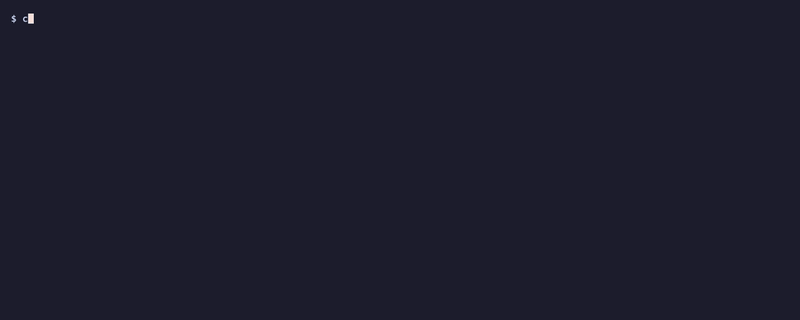

<h1 align="center">Model Supply Chain Scanner</h1>

<p align="center">
  <em>A tool that checks machine learning model files for hidden code, hidden file access and broken structure before they are loaded, without running anything from them.</em>
</p>

<p align="center">
  <a href="https://github.com/adeoluo/model-supply-chain-scanner/actions/workflows/ci.yml"></a>
  <a href="https://github.com/adeoluo/model-supply-chain-scanner/releases"></a>
  
  
  <a href="LICENSE"></a>
</p>

---

> **Evidence level: publicly benchmarked, with limits.** The scanner was compared with four other open-source model file scanners (picklescan, modelscan, fickling and ModelAudit). The test files came from three sources: the test files those projects publish, a set written by this scanner's author, and two samples of public files from the Hugging Face Hub (a public website for sharing machine learning models). The two Hub samples hold 12,573 files with no confirmed labels. The second sample was scanned with the scanner frozen, before any tuning on it. Attacks that outside reviewers got past the scanner are listed below with their fixes. Nobody else has reproduced these results, and the scanner is not used in production. [What the levels mean](https://github.com/adeoluo#evidence-levels).

## Highlights

AI model files can hide code that runs the moment someone loads them. This scanner, called
msscan, reads a model file **without loading it** and reports whether loading it would run
something dangerous.

- **msscan scores highest on the test files that other scanners publish.** Four other scanner
  projects publish 181 test files: 144 dangerous and 37 safe. msscan catches 141 of the 144
  and raises no false alarm (a safe file wrongly flagged). ModelAudit catches 139 with 4 false
  alarms, picklescan 113 with none, fickling 107 with 6 and modelscan 48 with none. Version
  0.1 of msscan caught 117, and version 0.2 was built against these files.
- **It flags every dangerous file found in two real-world samples.** Of 12,573 files from
  4,727 public Hugging Face repositories, 24 would run a command, call `eval` (run text as
  Python code) or read a file outside the model when loaded. msscan flags all 24. Of the 22
  that the other tools can read, ModelAudit flags 19, picklescan and fickling 12 each, and
  modelscan 7.
- **It raises few false alarms on real files.** In the first sample it raises 6 high-severity
  alerts on 8,495 files that carry no attack, compared with 31 on 7,563 for version 0.1. Two
  of the six are pickle files (Python's format for saved objects) that store whole functions,
  three hide a shell command in a text string, and one calls `print`. On the 1,694 pickle
  files that every tool read, msscan raises 3 alerts, picklescan and modelscan 1 each, and
  ModelAudit rates 275 critical.
- **It was tested on files it had never seen, and its errors are published.** A second sample
  of the newest repositories was scanned with the scanner frozen. It caught the 3 dangerous
  pickles, raised 14 false alarms on 4,023 clean files (picklescan raised 3) and rated one
  proof-of-concept attack file low. Each of those errors led to a fix. After the fixes the
  result is 5 of 5 dangerous files and 1 alert, but that result is no longer a test on unseen
  files.
- **It reads many file formats in one pass.** These are pickle, PyTorch, joblib, NumPy, Keras,
  ONNX, TensorFlow SavedModel, GGUF, safetensors, zip, 7z and tar archives, YAML and JSON
  configs, and chat templates. It also reads the code hidden inside Keras Lambda layers and
  inside text strings, without running it.
- **It is fast and uses little memory.** It scans a 284 MB model in under 0.01 seconds with
  4 MB of memory. On a 31 MB pickle it takes 0.16 seconds, compared with 6 seconds for
  picklescan, 6 for modelscan, 16 for ModelAudit and 37 for fickling.

**What it has not done:**

- **Found an attack nobody knew about.** Hugging Face's own scanners already flag 18 of the
  24 dangerous files. The other 6 are in repositories that present themselves as scanner
  tests, through their name, their description or their owner's other repositories.
- **Beaten ModelAudit by a meaningful margin.** 141 against 139 out of 144 is a difference of
  two files. msscan's three misses are ModelAudit test files that only name a custom Keras
  class and carry no code. msscan reports these at low severity on purpose.
- **Stayed quieter than picklescan on unseen files.** Before the fixes, msscan raised 14 false
  alarms on the second sample, compared with 3 for picklescan.
- **Passed outside review unchanged.** Three reviewers got files past version 0.1. Every gap
  is fixed and [listed below](#bypasses-found-by-outside-reviewers).

## Key terms

Plain definitions of the terms used in this README.

| Term | Meaning |
|---|---|
| Allowlist and denylist | An allowlist names functions known to be safe to load. A denylist names modules and functions known to be dangerous, such as `os` or `builtins.eval`. |
| Bypass | A file that does something dangerous but that a scanner rates as safe. |
| Corpus | A fixed set of test files used to measure scanners. |
| Deserialization | Turning saved bytes back into objects in memory. For pickle files this step can run code chosen by whoever made the file. |
| Detection rate | The share of dangerous files that a tool flags, from 0 to 1. Higher is better. |
| False alarm | A flag on a file that carries no attack. The false alarm rate runs from 0 to 1, and lower is better. |
| fickling | A pickle analysis and decompiling tool from Trail of Bits. One of the four tools compared here. |
| GGUF | A single-file format for language models, used by llama.cpp (a program that runs language models locally). Its header lists the tensors and can hold a chat template. |
| Ground truth | The confirmed answer to whether a file is dangerous. Public Hub files have none, so this project labels them from their contents. |
| Held-out sample | Files kept apart while the rules were built. Scanning them with the scanner frozen shows how it does on files it has never seen. |
| Hugging Face Hub | A public website where people share machine learning models and datasets. Anyone can upload files there. |
| Keras Lambda layer | A layer in a Keras model (Keras is a common neural network library) that stores a Python function as bytecode. Loading or using the model can run that function. |
| ModelAudit | A model file scanner from promptfoo that covers many formats. One of the four tools compared here. |
| modelscan | A model file scanner from Protect AI. One of the four tools compared here. |
| ONNX | Open Neural Network Exchange, a common model file format. A model can name separate files that hold its weights ("external data"). |
| Payload | The part of a malicious file that does the harm, such as running a command. In the Hub tables, a "payload" file is one that would do harm on load. |
| Pickle | Python's built-in format for saving objects, used inside PyTorch, joblib and some NumPy files (the "pickle family"). Loading a pickle can call any Python function it names. |
| picklescan | A small pickle scanner that the Hugging Face Hub also runs on uploaded files. One of the four tools compared here. |
| Proof of concept | A file made to show that an attack works, not to cause harm. |
| Safetensors | A model format designed to hold no code: a JSON header that describes the tensors, then raw numbers. A malformed header can still mislead a loader. |
| SARIF | Static Analysis Results Interchange Format, a standard JSON format for scanner results. GitHub code scanning reads it. |
| Severity | How serious a finding is: info, low, medium, high or critical. By default msscan counts a file as flagged at high or above. |
| Static scanner | A scanner that reads a file without loading or running it. |
| Symbolic virtual machine | A program that steps through a pickle's instructions and records what they would import and call, without running any of them. |
| Wilson interval | A 95% range for a rate measured on a sample. The true rate most likely lies inside it, and fewer files give a wider range. |

## Motivation

Loading a model often means running code. The loading step (deserialization, turning saved
bytes back into objects) can follow instructions that the file supplies. This happens with
`torch.load` with `weights_only=False` (PyTorch's loader when it accepts any pickle),
`pickle`, `joblib`, `np.load(allow_pickle=True)`, Keras Lambda layers, TensorFlow `PyFunc`
ops (graph steps that call Python) and chat templates rendered outside a sandbox. Chat
templates are small programs in the Jinja template language that format a conversation for a
language model.

Other files can make a loader read the wrong data. ONNX external data can point outside the
model. A malformed GGUF or safetensors header can make a loader read outside the model or past
the end of its memory buffers. A config can name a file on the machine that loads it. A
repository can carry a symbolic link (a file that points to another path) that leads out of
it. Model hubs host millions of these files, and the scanners in use each cover a different
subset of the formats.

`msscan` reads every format in one pass and imports nothing from the file. For pickles it
uses a symbolic pickle virtual machine. This program steps through each pickle instruction
(opcode) on a model of the stack, without running it. It records which globals (functions and
classes that the file names) are imported and which are called. Separate format analyzers
cover PyTorch zip and legacy checkpoints, joblib, NumPy, Keras files (`.keras`, HDF5 and
`keras_metadata.pb`), TensorFlow SavedModel, ONNX, GGUF, safetensors, zip, 7z and tar
archives, YAML and JSON configs and chat templates. msscan ships as a Rust program with text,
JSON and SARIF output (a standard report format that GitHub code scanning reads). It also
ships as an HTTP service, a GitHub Action (a step that GitHub's automation can run) and a
Python package that calls the same Rust core.

## Architecture

<p align="center">
  
</p>

<sub>Legend: amber = entry points and external systems, indigo = core logic, green = data and state, blue = validation and control, grey = observability and outputs.</sub>

The command-line tool (CLI), the HTTP service and the Python package all pass file paths or
bytes to the same Rust library. Files are memory-mapped: the operating system makes them
readable in place, without copying them first. Each file is identified by its content, and the
file extension is only used to report a mismatch. Containers are opened with size limits, and
their members are scanned one by one, including members inside nested containers. Containers
include PyTorch zips, `.npz` files, `.keras` archives, compressed streams, and 7z and tar
archives.

Pickles go through the symbolic virtual machine (VM) and three tiers of rules for globals: an
allowlist, a denylist, and the shape of a call. Their text constants are checked for a second
pickle or for code hidden inside. Keras, TensorFlow and ONNX graphs, GGUF and safetensors
headers, configs and chat templates each have their own analyzer. Keras Lambda bytecode is read
without running it. Symbolic links are followed inside the scanned folder and reported when
they point outside it.

Each finding carries a rule id, a severity and a location. The findings are summarized as a
verdict and a noisy-or risk score, which combines the findings as independent chances of harm
into one number from 0 to 100 (higher is riskier). These feed text, JSON or SARIF reports and
Prometheus metrics (a common format for monitoring counters). Details are in
[`docs/ARCHITECTURE.md`](docs/ARCHITECTURE.md), the rules in [`docs/RULES.md`](docs/RULES.md)
and the architecture decision records (ADRs) in [`docs/adr/`](docs/adr/).

## Results

All numbers come from runs on an Apple M1 computer (8 cores, 8 GB of memory). The versions are
msscan 0.2.0, picklescan 1.0.5, modelscan 0.8.8, fickling 0.1.13 and ModelAudit 0.2.58. Each
tool ran at its default settings through its Python API. A file counts as flagged when:

- msscan reports a finding at `high` or above (the default `--fail-on` level of its CLI).
- picklescan reports an infected file.
- modelscan reports any issue.
- fickling's `scan_file` rates the file above `LIKELY_SAFE`.
- ModelAudit reports an issue at warning or critical level, which is what makes its CLI exit
  with status 1. A second ModelAudit row counts critical issues only.

Each rate comes with a 95% Wilson interval: the range that most likely holds the true rate,
given how many files were tested.

There are four tests, in order of how much they prove. Each row of the table below is one
test. The columns say who wrote the files and whether msscan's rules were tuned on them,
because tuning on a set of files makes the result on that set look better than on new files.

| Test | Who wrote the files | Were msscan's rules tuned on them? |
|---|---|---|
| 1. Other projects' test files (181) | the four other scanner projects | yes, version 0.2 was built against them |
| 2. Authored corpus (243) | the author of msscan | yes |
| 3. Hugging Face, first sample (8,541) | the public | yes |
| 4. Hugging Face, second sample (4,032) | the public | **no** for the frozen run, yes after it |

### 1. Test files written by the other scanner projects (181 files)

[`benchmarks/third_party.py`](benchmarks/third_party.py) copies the test files that
picklescan, ModelAudit, modelscan and fickling keep in their own repositories. Their tests say
that 144 of these files must be flagged and 37 must pass. Each label comes only from what the
original project's test asserts, never from any tool's verdict here. Many of the malicious
files are the proof-of-concept files of published advisories about scanner bypasses.
`make third-party` clones the four repositories and reruns everything. Raw results are in
[`third_party.md`](benchmarks/results/third_party.md).

Each row below is one tool or tool setting, and each cell shows a count, the rate and its
Wilson interval. Higher is better for malicious files detected, and lower is better for benign
files flagged and for files not scanned.

| Tool | Malicious detected (144) | Benign flagged (37) | Files not scanned or with errors |
|---|---:|---:|---:|
| **msscan** (high) | **141 = 0.979 (0.941 to 0.993)** | **0 = 0.000 (0.000 to 0.094)** | 0 |
| msscan (medium) | 141 = 0.979 (0.941 to 0.993) | 7 = 0.189 (0.095 to 0.342) | 0 |
| ModelAudit | 139 = 0.965 (0.921 to 0.985) | 4 = 0.108 (0.043 to 0.247) | 7 |
| ModelAudit (critical only) | 134 = 0.931 (0.877 to 0.962) | 1 = 0.027 (0.005 to 0.138) | 7 |
| picklescan | 113 = 0.785 (0.711 to 0.844) | 0 = 0.000 (0.000 to 0.094) | 6 |
| picklescan `--strict` | 114 = 0.792 (0.718 to 0.850) | 2 = 0.054 (0.015 to 0.177) | 6 |
| fickling | 107 = 0.743 (0.666 to 0.807) | 6 = 0.162 (0.077 to 0.311) | 51 |
| fickling (overtly malicious only) | 96 = 0.667 (0.586 to 0.738) | 0 = 0.000 (0.000 to 0.094) | 51 |
| modelscan | 48 = 0.333 (0.262 to 0.414) | 0 = 0.000 (0.000 to 0.094) | 57 |

By source: on picklescan's 94 malicious files, msscan and picklescan both catch 94, ModelAudit
89, fickling 88 and modelscan 28. On ModelAudit's 49, ModelAudit catches 49, msscan 46,
modelscan 19, and picklescan and fickling 18 each.

**What this result means.**

- The gap between msscan and ModelAudit is two files, and their intervals overlap almost
  entirely. The fair summary is that both catch nearly everything here, and msscan does it
  with no false alarm.
- Every malicious file that msscan catches is also caught by at least one other tool. msscan
  catches nothing in this set on its own.
- msscan's three misses are ModelAudit files: Keras HDF5 models that name a custom layer, loss
  or metric but contain no code. Loading them needs the caller to supply that code. So msscan
  reports them at low (rule MS503), and that is a decision, not an oversight.
- ModelAudit's five misses are picklescan files: zip archives whose headers were altered so
  that a scanner and PyTorch read different members.
- Version 0.1.1 of msscan caught 117 of the 144. Of the 141 caught now, 21 are caught only by
  rules that are new in 0.2. Of those 21, 20 rely on refusing calls by their shape, that is, by
  the kind of function called instead of its name on a list
  ([ADR 0007](docs/adr/0007-refuse-calls-by-shape.md)). These files were the target while that
  work was done, so 141 is a fitted number.
- Two faults in this project's test harness first made ModelAudit look worse (124 detected, 8
  false alarms). Its chat-template test files were scanned under file names it does not
  recognize, and its output was silenced in a way that changed its verdicts. Both faults are
  fixed, and the figures above are from after the fix.

### 2. Authored corpus (243 files, 100 techniques)

[`benchmarks/corpus/generate.py`](benchmarks/corpus/generate.py) writes 142 malicious files
and 101 benign files. The malicious files cover 100 attack techniques in 15 format families.
Most of the benign files are written by the real libraries (PyTorch, scikit-learn, joblib,
NumPy, Keras, ONNX, safetensors). Every payload is inert: it prints a marker text (a canary),
returns `os.getcwd()` or names a file that does not exist.
[`validate.py`](benchmarks/corpus/validate.py) loaded each file with its real loader in a
separate process. All 106 malicious files that have a Python loader ran their payload or were
rejected, and all 72 benign files that have one loaded. Raw results are in
[`synthetic.md`](benchmarks/results/synthetic.md).

The table below has the same layout as in test 1: one row per tool or setting, with a count,
the rate and its Wilson interval. Higher is better for malicious files detected, and lower is
better for benign files flagged and for files not scanned.

| Tool | Malicious detected (142) | Benign flagged (101) | Files not scanned or with errors |
|---|---:|---:|---:|
| **msscan** (high) | **142 = 1.000 (0.974 to 1.000)** | **0 = 0.000 (0.000 to 0.037)** | 0 |
| msscan (medium) | 142 = 1.000 (0.974 to 1.000) | 6 = 0.059 (0.028 to 0.124) | 0 |
| ModelAudit | 128 = 0.901 (0.841 to 0.940) | 55 = 0.545 (0.448 to 0.638) | 18 |
| ModelAudit (critical only) | 103 = 0.725 (0.647 to 0.792) | 14 = 0.139 (0.084 to 0.219) | 18 |
| picklescan | 71 = 0.500 (0.419 to 0.581) | 3 = 0.030 (0.010 to 0.084) | 16 |
| picklescan `--strict` | 83 = 0.585 (0.502 to 0.662) | 26 = 0.257 (0.182 to 0.350) | 16 |
| fickling | 75 = 0.528 (0.446 to 0.608) | 36 = 0.356 (0.270 to 0.454) | 115 |
| fickling (overtly malicious only) | 71 = 0.500 (0.419 to 0.581) | 9 = 0.089 (0.048 to 0.161) | 115 |
| modelscan | 40 = 0.282 (0.214 to 0.361) | 0 = 0.000 (0.000 to 0.037) | 119 |

**What 142 of 142 means.** The author of the scanner wrote this corpus. So it is a regression
gate (a check that known attacks stay caught) and a map of coverage. It is not an estimate of
how many unknown attacks msscan would catch. A new file is added each time something gets past
the scanner, which is why it never misses here. msscan alone flags eleven of these files:
malformed GGUF and safetensors headers, unsafe YAML and Hydra configs (Hydra is a config
library that can create the Python objects a config names), a SavedModel op that lists files,
and checkpoint indexes that point outside the model. That also follows from who wrote them.
The benign side is more useful. It includes the file shapes that were false alarms in the two
Hugging Face samples. Also, 39 of the 55 benign files that ModelAudit flags are joblib and
PyTorch checkpoints written by the real libraries.

### 3. Hugging Face, first sample (8,541 real files from 2,789 repositories)

[`benchmarks/hf/collect.py`](benchmarks/hf/collect.py) fetched only what a scanner reads. It
used no login token, and it used HTTP range requests, which download only part of a file. It
fetched the pickle members of PyTorch zip checkpoints (rebuilt into small stub archives),
`.keras` configs, safetensors and GGUF headers, and whole files up to 20 MB for other formats.
The repositories are the list drawn for version 0.1: the most downloaded, most recently
changed and most liked, plus format filters. Version 0.1 did not keep the files. So they were
fetched again on 2026-11-23 and kept (3.7 GB), which is why the counts differ from the 7,607
files reported before.

The files are 2,827 JSON configs, 2,587 safetensors headers, 1,710 pickle-family files
(PyTorch, pickle, joblib, NumPy), 525 Keras archives, 432 GGUF headers and 460 ONNX, HDF5 and
SavedModel files. Files found in the wild have no ground truth. So
[`review.py`](benchmarks/hf/review.py) labels each file from what it contains, never from a
tool's verdict:

- **payload**: loading the file reaches a function that runs system commands or evaluates
  code, or it reaches a file outside the model. Examples of the first kind are a pickle that
  calls into `os`, `posix`, `nt`, `subprocess`, `sys`, `requests` or `builtins.eval`, a Keras
  config that names such a module, and a GGUF template that reaches Python internals.
  Examples of the second kind are an ONNX external-data path, a checkpoint index, a Keras
  layer config and a stored link.
- **security-test**: other files in repositories that describe themselves as security test
  material, such as crafted malformed files and benign baseline files.
- **code-by-design**: loading runs code that is not plain data, on purpose. Examples are Keras
  Lambda layers or classes from outside Keras, pickles that call modules outside the known
  libraries, TorchScript (PyTorch's format for saved programs) and Hugging Face configs that
  ask for remote code.
- **nonstandard**: the file breaks the current format specification but was written by
  legitimate tools. Examples are five-dimensional GGUF tensors, GGUF type ids that llama.cpp
  does not define, safetensors data sections with bytes that no tensor covers, and pickles
  that end early.
- **benign**: everything else.

The other tools receive the 2,695 files stored in full: pickle-family, Keras, ONNX, HDF5 and
SavedModel files. Safetensors headers, GGUF headers and JSON configs go to msscan only,
because the other tools do not read these formats from a header alone.

Each row below is a group of files (a second count in the label is how many of them the other
tools received), and each column is a tool or setting. Higher is better in the payload and
security-test rows, and lower is better in the "no attack" rows, which count false alarms.

| Files | msscan (high) | picklescan | picklescan `--strict` | modelscan | fickling (overtly malicious) | fickling | ModelAudit (critical) | ModelAudit |
|---|---:|---:|---:|---:|---:|---:|---:|---:|
| payload (19; 18 for the others) | **19/19** | 9/18 | 9/18 | 6/18 | 9/18 | 9/18 | 16/18 | 16/18 |
| pickle-family payloads (12) | **12/12** | 9/12 | 9/12 | 6/12 | 9/12 | 9/12 | **12/12** | **12/12** |
| security-test (27; 20) | 6/27 | 0/20 | 0/20 | 2/20 | 0/20 | 0/20 | 4/20 | 7/20 |
| no attack: all formats (8,495; 2,657) | 6 = 0.001 (0.000 to 0.002) | **1 = 0.000 (0.000 to 0.002)** | 634 = 0.239 | **1 = 0.000 (0.000 to 0.002)** | 170 = 0.064 | 1,358 = 0.511 | 357 = 0.134 | 1,606 = 0.604 |
| no attack: pickle family (1,694) | 3 = 0.002 (0.001 to 0.005) | **1 = 0.001 (0.000 to 0.003)** | 633 = 0.374 | **1 = 0.001 (0.000 to 0.003)** | 170 = 0.100 | 1,358 = 0.802 | 275 = 0.162 | 1,394 = 0.823 |

msscan flags all 19 payload files. ModelAudit flags every pickle-family one but misses two
Keras archives whose config imports a system module. picklescan, fickling and modelscan miss
the three zlib-compressed joblib and pickle files that call `builtins.eval`, the Keras configs
and the ONNX paths. On files without an attack, picklescan and modelscan still raise the
fewest alerts: one each, compared with three for msscan on the same pickle files.

msscan's six high alerts on files without an attack are:

- two pickles that carry whole functions and classes saved by `dill` (a library that extends
  pickle to save functions). The code is in the file by design, and Hugging Face's scanners
  flag both.
- three pickles named `.keras` that hold the text
  `lambda x: exec('import os; os.system(...)')` as a string. Loading them runs nothing, but
  code that evaluates the string would. They sit in a repository of generated test files next
  to real payload files. ModelAudit flags them too, while picklescan, modelscan and fickling
  pass them.
- one pickle that calls `builtins.print`, in a repository that also holds payload files.
  fickling flags it too.

Version 0.1.0 raised 31 high alerts on 7,563 such files. Four changes explain the difference.
Keras Lambda layers are now read as bytecode and graded by the names they use, so the 9 here
that are not test material, which only do arithmetic, are medium. GGUF files with
five-dimensional tensors or unknown type ids are now low (22 files). Lookups such as
`getattr(Class, "method")` are resolved to the function they name. A macOS metadata file or a
TensorFlow.js shard is no longer read as a broken safetensors header. msscan reports a further
184 files at medium.

The labels rely on msscan's parsers to read structure (imports, Lambda layers, header fields).
So a construct those parsers miss is invisible to the labels too. For that reason the payload
row counts what the other tools miss, not what msscan misses, and the security-test group is
reported on its own. Of its 27 files, msscan flags 6 at high (crafted GGUF structures, and
Lambda layers that import or evaluate code) and 2 more at medium. The others are benign
baselines, weight backdoors (hidden behaviour trained into the numbers, out of scope for a
static scanner), an ONNX docstring injection (text planted in the model's description field),
and safetensors files with odd tensor names. They also include a Keras zip-slip member (an
archive entry whose name climbs out of the target folder) and a decompression bomb (a small
archive that expands to a huge size), which the headers-only collection did not fetch. Raw
rows, with pseudonymous ids and no repository names, are in
[`hf_corpus.json`](benchmarks/results/hf_corpus.json). Labels and tables are in
[`hf_review.md`](benchmarks/results/hf_review.md).

### 4. Hugging Face, second sample (4,032 files from 1,938 repositories, never tuned on)

Tests 1 to 3 measure files that shaped the rules. This test does not. `make hf-heldout` lists
the most recently created model repositories on the Hub and drops every repository of the
first sample. It then fetches the same kinds of files, plus YAML configs, chat templates and
archives (2.7 GB). **The scanner's code was committed before the first scan of this sample**,
and that scan is published as measured
([`hf_heldout_frozen_review.md`](benchmarks/results/hf_heldout_frozen_review.md)). The
reasoning is in [ADR 0008](docs/adr/0008-held-out-sample-and-what-it-changed.md).

Each row below is a group of files and each column is a tool, with msscan shown both frozen
(the unseen run) and after the fixes. Higher is better in the first two rows, and lower is
better in the "no attack" rows, which count false alarms.

| Files | msscan (high), frozen | msscan (high), after fixes | picklescan | modelscan | fickling (overtly malicious) | ModelAudit (critical) | ModelAudit |
|---|---:|---:|---:|---:|---:|---:|---:|
| pickles that run a command or `eval` (3) | 3/3 | 3/3 | 3/3 | 1/3 | 3/3 | 3/3 | 3/3 |
| files that read outside the model (2; 1 for the others) | 1/2, as a broken header | 2/2 | 0/1 | 0/1 | 0/1 | 0/1 | 0/1 |
| no attack: all formats (4,023; 2,313) | 14 = 0.003 (0.002 to 0.006) | 1 = 0.000 (0.000 to 0.001) | **3 = 0.001 (0.000 to 0.004)** | **1 = 0.000 (0.000 to 0.002)** | 304 = 0.131 | 453 = 0.196 | 1,234 = 0.534 |
| no attack: pickle family (1,347) | 11 = 0.008 (0.005 to 0.015) | 1 = 0.001 (0.000 to 0.004) | **3 = 0.002 (0.001 to 0.007)** | **1 = 0.001 (0.000 to 0.003)** | 304 = 0.226 | 414 = 0.307 | 1,066 = 0.791 |

**What the frozen scanner got wrong.** These errors are the main result of this test.

- **14 false alarms, compared with 3 for picklescan and 1 for modelscan.** Eight were
  scikit-learn pipelines that store `functools.partial(check_array, ...)` inside a
  `FunctionTransformer`. A `partial` is a function saved together with some of its arguments.
  One was a PyTorch Lightning checkpoint storing `partial(Adam, ...)`, and one a pipeline
  storing `operator.methodcaller("__floordiv__", 3600)`. One was a YAML config using
  `!!python/tuple`, and one an encoded Git LFS pointer (a small text file that stands in for
  a large file stored elsewhere) saved under a `.safetensors` name. None of these twelve runs
  anything on load. The other two are a file that is still flagged (below) and the stored
  link (below), which the frozen run's own labels counted as a clean file. Two rules assumed
  that ordinary files do not store functions this way. One is the denylist entries for
  `operator.methodcaller` and for `functools.partial`, the second added after an outside
  review. The other is the call-shape rule that wins points in test 1. That assumption held
  for the 8,541 files of the first sample and failed on the next 4,032.
- **One proof-of-concept attack rated low.** It is a Keras archive whose tokenizer layer
  config names a file path on the machine that loads it, so loading the model reads that
  file. It is in a repository that declares itself a proof of concept. No tool flagged it.
- **One right alert for the wrong reason.** A 21-byte file named `.safetensors` holds only
  the text `../../../etc/hostname`: it is a symbolic link stored as a file. msscan rated it
  high as a broken header, not as what it is.
- **A real bug.** Scanning a Hugging Face cache folder reported zero files scanned. Every file
  in a cache snapshot is a symbolic link, and the folder walk skipped links.

**What changed.** A stored function is no longer treated as a function that runs. A `partial`
around a function that is not dangerous, or a `methodcaller` with an ordinary method name, is
now medium (MS118), unless the pickle goes on to call it. Three new rules cover paths that
leave the model: a stored or real symbolic link (MS206), a path in a Keras layer config
(MS506) and a shard path in a checkpoint index (MS1004). MS1004 was written after reading the
other files of the repository that held the stored link. Folder scans now follow links inside
the folder and into the Hugging Face cache. They report links that leave it, without opening
them.

**What the "after fixes" column is.** It is a regression check on the files the fixes were
written for. It is not a second unseen measurement, and no unseen sample is left. The one
remaining alert is a joblib file with an embedded pickle that rebuilds a compiled function
through `numba`'s cloudpickle. numba is a compiler for numeric Python code, and cloudpickle
is a pickle extension that saves functions, so this is code in the file by design.

### Were the dangerous files already known?

Yes, all 24 were. [`benchmarks/hf/hub_status.py`](benchmarks/hf/hub_status.py) asks the
Hub's public API what the Hub's own scanners (Protect AI Guardian, JFrog, picklescan, ClamAV
and VirusTotal) say about every file that msscan rates high. It also checks whether the
repository presents itself as security test material: by its name, in its model card (the
repository's description page), or because its owner publishes other repositories named as
scanner tests. The check ran on 2026-11-23 with `make hf-status` and `make hf-heldout`. Raw
rows with pseudonymous ids are in [`hf_hub_status.json`](benchmarks/results/hf_hub_status.json)
and [`hf_heldout_hub_status.json`](benchmarks/results/hf_heldout_hub_status.json).

Each column below is one Hub sample, and each row counts payload files by what the Hub and
the repository say about them. The last row counts possible new finds, and it is zero in
both samples.

| | First sample | Second sample |
|---|---:|---:|
| Payload files | 19, in 6 repositories | 5, in 4 repositories |
| Flagged by the Hub (unsafe or suspicious) | 16 | 2 |
| Not flagged by the Hub (safe, or a scan still queued) | 3 | 3 |
| In repositories that present themselves as security tests | 17 | 3 |
| Neither flagged by the Hub nor in a test repository | **0** | **0** |

So msscan found nothing new, and nothing here should be called a discovery. The check does
show coverage. The Hub did not flag six files: two ONNX models whose external-data path leaves
the model folder, a compressed pickle that calls `builtins.eval`, a pickle that calls `eval`
and is followed by 3.5 MB of zero bytes, the Keras archive with a file path in its tokenizer
config, and the stored symbolic link. Each one is somebody's published test of a scanner, and
msscan happens to cover all six.

This check has limits. Files were matched by path on today's `main` branch, not by hash (a
fingerprint of the content), so a file may have changed since it was fetched. The statuses
are a snapshot, and several moved between safe and queued during the day. The test for "a
scanner test" is a match on names and words. No search was made of advisories or bug-bounty
reports.

### Speed and memory

[`benchmarks/speed.py`](benchmarks/speed.py) runs each tool on each file three times, each
time in a fresh process under `/usr/bin/time -l`. It reports the median wall time (elapsed
clock time) and the peak resident memory (the most memory in use at once). For the Python
tools, both include interpreter start-up and imports. The checkpoints are real Hub files: the
Helsinki-NLP opus-mt-en-de and opus-mt-en-fr PyTorch zips, and the Qwen3.5-0.8B safetensors
file. The plain-data pickle (31 MB, about 3.35 million list items, no globals) is generated
with random seed 0. The machine was otherwise idle, which is why the other tools are faster
here than in the 0.1 table. Raw runs are in [`speed.json`](benchmarks/results/speed.json).

Each row below is a tool and each column is a test file. Each cell gives the median time in
seconds and the peak memory in MB, and lower is better for both.

| Tool | opus-mt-en-de `.bin` (284 MB) | opus-mt-en-fr `.bin` (287 MB) | Qwen3.5-0.8B `.safetensors` (1,666 MB) | plain-data pickle (31 MB) |
|---|---:|---:|---:|---:|
| **msscan** (binary) | < 0.01 s, 4 MB | < 0.01 s, 4 MB | < 0.01 s, 4 MB | 0.16 s, 241 MB |
| msscan (Python package) | 0.04 s, 21 MB | 0.04 s, 21 MB | 0.03 s, 22 MB | 0.18 s, 258 MB |
| picklescan | 0.06 s, 26 MB | 0.06 s, 26 MB | 0.05 s, 24 MB | 6.1 s, 900 MB |
| modelscan | 0.10 s, 40 MB | 0.10 s, 40 MB | 0.10 s, 40 MB | 6.1 s, 915 MB |
| ModelAudit | 3.2 s, 178 MB | 3.3 s, 185 MB | 6.8 s, 107 MB | 16 s, 1,106 MB |
| fickling | 1.0 s, 494 MB | 0.95 s, 497 MB | 2.1 s, 1,046 MB | 37 s, 1,605 MB |

msscan memory-maps the file and reads only the pickle members of a zip or the header of a
safetensors file. So its cost does not grow with the size of the weights. On the plain-data
pickle, every tool must walk through each opcode. There msscan takes 0.16 to 0.18 s,
compared with 6.1 s for picklescan and modelscan, 16 s for ModelAudit and 37 s for fickling.

On the first Hub sample, msscan scanned all 8,541 files in 18 s in one process. On the 2,695
files the other tools received, picklescan took 56 s, modelscan 29 s, fickling 312 s and
ModelAudit about two hours (7,407 s, while a second ModelAudit run shared the machine).
msscan 0.2.0 is slower per file than 0.1.0, which took 9.8 s for 7,607 files. The likely
cause is that it now also inspects text constants and decodes Lambda bytecode, but this was
not confirmed by profiling.

## Quickstart

Build the command-line tool and scan the bundled test files:

```bash
git clone https://github.com/adeoluo/model-supply-chain-scanner && cd model-supply-chain-scanner
cargo build --release -p msscan            # or download a binary from the releases page
./target/release/msscan scan tests/fixtures
```

Python package (it compiles the Rust core with maturin, a tool that builds Rust code into
Python packages):

```bash
uv sync
uv run python -c "import msscan; print(msscan.scan_file('tests/fixtures/malicious_torch.pt').summary())"
```

## Usage

### Command line

```bash
msscan scan model.pt models/                # text report; exit status 1 at high or above
msscan scan -f sarif -o report.sarif models/ --fail-on critical
msscan scan -f json --hash --min-severity info model.gguf
msscan rules --format markdown              # the 54 rules
python -m msscan scan models/               # the same scan from the Python package
```

Exit status: 0 when nothing reaches the `--fail-on` level, 1 when something does, and 2 on
usage errors or input and output (I/O) errors. Formats are detected by content, so renamed
files are still scanned.

### Library

```python
import msscan

report = msscan.scan_file("pytorch_model.bin")
print(report.verdict, report.risk_score)            # "clean", "suspicious", "unsafe" or "malicious"
for f in report.findings:
    print(f.severity, f.rule, f.message, f.location)

msscan.scan_bytes(header_bytes, "model.safetensors", declared_size=total_size)  # headers only
print(msscan.render(msscan.scan_path("models/"), "sarif"))
```

### HTTP service

```bash
msscan serve --addr 127.0.0.1:8080
curl --data-binary @model.pt 'localhost:8080/v1/scan?name=model.pt'
curl localhost:8080/health; curl localhost:8080/ready; curl localhost:8080/metrics
```

`docker compose up --build` runs the same service in a Docker container (a packaged,
isolated environment).

### GitHub Action

```yaml
- uses: adeoluo/model-supply-chain-scanner@v0.2.0
  with:
    path: models/
    output: msscan.sarif
    fail-on: high
- uses: github/codeql-action/upload-sarif@v4
  with:
    sarif_file: msscan.sarif
```

### Demos

These recordings come from real runs made with [vhs](https://github.com/charmbracelet/vhs), a
tool that records terminal sessions. Each recording script (tape) is in `docs/demo/`.

Scanning the bundled harmless test files (fixtures), with findings, locations and verdicts.

<p align="center">
  
</p>

A SARIF report for code scanning, read with jq (a command-line JSON tool).

<p align="center">
  
</p>

The HTTP service scanning an uploaded checkpoint, and its metrics.

<p align="center">
  
</p>

The Python API on three files: a `__setstate__` injection (a pickle that replaces the method
that restores an object), a dynamic import hidden with rot13 (a simple letter-shifting code)
and a clean state dict (a plain set of PyTorch weights).

<p align="center">
  
</p>

## Design decisions

- **One Rust core for every interface** ([ADR 0002](docs/adr/0002-rust-core-with-python-bindings.md)):
  the CLI, the service and the Python package share one implementation, so the benchmarks
  measure what users run. A small Python reference analyzer exists only for parity tests,
  which check that both give the same answers.
- **Symbolic execution of pickles** ([ADR 0003](docs/adr/0003-symbolic-pickle-vm.md)): every
  opcode is applied to a model of the stack. So msscan can tell whether a global is called or
  only imported. It also catches dynamic imports (`STACK_GLOBAL` names built at load time)
  and `BUILD` writes to dunder attributes (special Python names such as `__setstate__`).
  Nested `pickle.loads` payloads are analyzed recursively. Globals are sorted into four tiers:
  safe, library, unknown or dangerous.
- **Severities, verdicts and a noisy-or score** ([ADR 0004](docs/adr/0004-risk-scoring-and-verdicts.md)):
  findings keep their own severity. The verdict and the score summarize them for pass or fail
  checks (gates).
- **Keras configs from raw bytes** ([ADR 0005](docs/adr/0005-configs-from-raw-bytes.md)): HDF5
  and `keras_metadata.pb` files are searched for embedded JSON configs instead of being parsed
  as HDF5. This keeps the program free of native HDF5 libraries.
- **A Hub corpus from headers, published without names** ([ADR 0006](docs/adr/0006-hub-corpus-headers-only.md)):
  only the bytes a scanner reads were fetched. Results carry salted pseudonyms, which are ids
  hashed with a secret value so that they do not reveal the repository.
- **Calls refused by their shape** ([ADR 0007](docs/adr/0007-refuse-calls-by-shape.md)): msscan
  refuses a pickle that calls a standard-library function, a method reached through an
  attribute path, or a library function that is not a class or a rebuild helper. The function
  does not have to be on any list.
- **A sample the rules never saw, and a record of what it changed** ([ADR 0008](docs/adr/0008-held-out-sample-and-what-it-changed.md)):
  the scanner is frozen before a new sample is scanned, and that result is published. Only
  then are the false alarms fixed.

## Testing

```bash
make lint        # cargo fmt --check, clippy -D warnings, ruff format --check, ruff check
make type        # mypy src
make test        # cargo test (unit, property and CLI tests) and pytest
make coverage    # Rust line coverage gate 85%, Python coverage gate 80%
```

The project has 137 Rust tests, which cover 95% of the Rust lines (measured with
`cargo llvm-cov`), and 30 Python tests, which cover 92% of the Python code. They cover:

- **Pickle VM** (`pickle/tests.rs`): every opcode family across pickle protocols 0 to 5 (the
  versions of the pickle format), `GLOBAL`, and `STACK_GLOBAL` with names computed at load
  time (`_codecs.encode` rot13). Also `INST`, `OBJ` and `NEWOBJ`, `BUILD` writes to dunder
  attributes and `__setstate__`, memo tricks, nested `pickle.loads` payloads, joblib array
  skipping and limits. Property tests (tests on many random inputs) check that random bytes
  never make the scanner panic. Further tests cover the call-shape rule, resolved lookups
  (`getattr(Class, "name")`, dill type names), stored calls (`partial`, `methodcaller`),
  unused `EXT` lookups and payloads hidden in text constants.
- **Formats** (`scan/tests.rs` and one module per format): zip traversal and header mismatch,
  encrypted members, decompression bombs, legacy PyTorch, NumPy object arrays, Keras Lambda
  and module rules, SavedModel ops, and ONNX external data in subgraphs. Also GGUF counts,
  lengths, types, bounds and chat templates, safetensors offsets and headers-only prefixes,
  and a property test over ten formats with random bytes added at the end. Further tests
  cover 7z and tar members, Lambda bytecode from CPython (the standard Python interpreter)
  3.9 to 3.16, file paths in Keras configs, YAML tags and Hydra targets, checkpoint indexes,
  Git LFS pointers, and symbolic links inside and outside the scanned folder.
- **Policy**: tier assignments for denylisted modules, dotted attribute paths and library
  namespaces. This includes the split inside `torch.distributed`, where the parts that run
  commands, remote calls or file access are dangerous and tensor classes stay library code.
- **Parity** (`tests/test_parity.py`): the Rust VM reports the same imports and calls as the
  Python reference analyzer. This is checked on objects generated by hypothesis (a Python
  library that generates test inputs) for every protocol, on optimized pickles and on
  hand-written tricks.
- **Interfaces**: CLI exit codes and the three report formats (Rust and Python), the Python
  API, the HTTP service (`/health`, `/ready`, `/metrics`, `/v1/scan`), the verdict of every
  bundled fixture, and the benchmark scoring and Hub labeling code.

Continuous integration (CI, the checks that run automatically on every change) runs format,
lint and type checks and both coverage gates on Python 3.12, 3.13, 3.14 and 3.15. It also
runs the Rust tests, the release binary on the fixtures with SARIF output, this repository's
GitHub Action, and a Docker build probed over HTTP. CodeQL (GitHub's code security analysis)
runs on pushes to main and once a week.

## Responsible AI

- **Threat model:** [`docs/THREAT_MODEL.md`](docs/THREAT_MODEL.md) lists the attack
  techniques, the rules that cover them and the attacks that are out of scope.
- **Standards:** the [threat model](docs/THREAT_MODEL.md#standards-mapping) maps every rule
  family to two public catalogs of AI risks. The first is LLM04:2026 Supply Chain in the
  OWASP Top 10 for LLM Applications 2026, a list of the main security risks for applications
  built on large language models (LLMs). The second is MITRE ATLAS v2026.10, a knowledge base
  of attacks on AI systems. Examples are AML.T0011.000 User Execution: Unsafe AI Artifacts,
  AML.T0018.002 Manipulate AI Model: Embed Malware and AML.T0076 Corrupt AI Model.
- **Data card:** [`docs/DATA_CARD.md`](docs/DATA_CARD.md) describes the four sets of files.
- **Inert fixtures:** every malicious file in the repository and in the generated corpus
  calls a harmless function (`print`, `os.getcwd`) or names a file that does not exist. None
  of them deletes anything, writes outside the corpus folder or opens a network connection.
- **Hub data:** files were read for security analysis and not shared further. Repository
  names stay outside this repository, and no repository owner was contacted.

## Bypasses found by outside reviewers

Three independent reviews in November 2026 tested version 0.1 with pickles that the
reviewers wrote without seeing its rules. Every bypass they reported is listed here with its
fix, and each fix has a regression test (a test that fails if the problem comes back).

Each row below is one reported bypass. The columns give msscan's verdict when it was
reported, the cause, and how msscan rates it now.

| Reported bypass | Verdict when reported | Cause | Now |
|---|---|---|---|
| `torch.utils.collect_env.run` (runs a shell command), `functools.partial`, `pydoc.pipepager` | clean, clean, medium | any callable under a library namespace passed unless denylisted by exact name | critical (MS101). `partial` is critical when it wraps a dangerous function or its result is called, and medium when it only stores a library function (MS118) |
| A protocol 0 pickle with no header and no final `STOP`, named `.pkl` or `.pt` | `unknown`, clean, risk 0 | format detection required a header or a terminating `STOP`; Python runs the payload before raising | malicious (MS101 and MS109) |
| A pickled `keras.layers.Lambda`; `transformers.dynamic_module_utils.get_class_from_dynamic_module` | low or clean | same namespace rule as the first row | critical when called, high when referenced |

Each of these fixes added names to a list, and each review then found another name. Version
0.2 no longer depends on the list alone. It refuses a called global at high (MS115) in three
cases, even when the global is on neither the allowlist nor the denylist. The cases are a
standard-library function outside a short allowlist, a method reached through an attribute
path, and a library function that is neither a class nor a rebuild helper
([ADR 0007](docs/adr/0007-refuse-calls-by-shape.md)). The catalog is still there: 183
denylisted modules, 145 exact names, and 76 loader-style names refused inside library
namespaces. It now decides between critical and high, not between caught and missed.

The cost was measured twice. On the first Hugging Face sample, the shape rule raised one
alert on a file without an attack (a pickle that calls `print`). On the second sample, which
the rules had not seen, ten pipelines that store a function for later use were flagged. All
ten were flagged through the denylist (`functools.partial`, which the first review led to,
dill's name for it, and `operator.methodcaller`), and eight of them by the shape rule as
well. Both rules were narrowed
(see [test 4](#4-hugging-face-second-sample-4032-files-from-1938-repositories-never-tuned-on)).

What this does not show: the reviewers found these gaps with a few dozen test files each,
which indicates that more gaps exist. A class whose constructor (the code that creates an
object) runs code still passes as library code, if it is inside a trusted library and not in
the catalog.

## Limitations

- **A static scanner sees only what the file declares.** Attacks that live in the weights,
  such as backdoors or poisoned behaviour, are out of scope.
- **Classes are trusted more than functions.** Inside the 79 namespaces treated as libraries,
  calling a class is rated low. A class that runs code when it is created, and is not in the
  catalog, passes. A function from an unknown third-party package is rated medium, below the
  default failure threshold.
- **A stored function is medium.** A `functools.partial` around a library function that no
  list names, kept for the model to call later, does not fail a scan (MS118). If that
  function runs code when the pipeline calls it, msscan does not say so.
- **Hidden payloads are found only by known shapes.** Text is checked for nested pickles and
  for a fixed list of code-running calls, in plain text, base64 or hex. Other encodings, and
  code that reaches the same effect without those calls, are not found.
- **Lambda bytecode is graded by the names it carries.** Code that reaches something
  dangerous through names outside the risky list is rated medium.
- **Custom Keras objects named without code are low.** This causes the three misses in
  test 1.
- **Links that leave the scanned folder are reported, not followed,** so their targets are not
  scanned. RAR archives are reported as not scanned.
- **No unseen test set is left.** The second Hugging Face sample was used to fix the scanner
  after its frozen run, so the next release needs a new one. The Hub labels come from msscan's
  own parsers, so they cannot show an attack those parsers do not read.
- **The comparison uses each tool's defaults through its Python API.** ModelAudit was run
  without its cloud features. Its warning level is counted as a flag because that is what
  fails its command line. Two harness faults that hurt ModelAudit were found and fixed, and
  others may remain.
- **Headers-only scanning of the Hub samples** skips archive members other than pickles and
  configs. So zip-slip names and decompression bombs in large `.keras` archives were not
  measured there.
- **Format rules follow one reference.** GGUF checks follow the limits of llama.cpp, and Keras
  resolution rules differ across versions. MS505 assumes a loader might import the
  third-party module named in the config.

## Roadmap

- [ ] A third Hugging Face sample, scanned with the scanner frozen, before the next release.
- [ ] Follow a stored function (MS118) to the place where a pipeline calls it.
- [ ] Streaming scans of remote files over HTTP range requests from the CLI.
- [ ] More formats: TorchScript code, TensorFlow Lite flatbuffers, Core ML, PaddlePaddle, RAR.

## License

Released under the [MIT License](LICENSE).
