# Architecture

```
crates/msscan-core   parsers, pickle VM, rules, reports, HTTP service (Rust library)
crates/msscan-cli    the msscan binary (scan, rules, serve)
crates/msscan-py     PyO3 bindings, compiled into the Python package as msscan.msscan_rs
src/msscan           typed Python API, python -m msscan, reference pickle analyzer
benchmarks/          corpus generator, loader validation, comparison harness, Hub collector
```

## Request path

1. `scan_path` walks files (hidden directories skipped) and scans them in parallel with rayon.
   Each file is memory-mapped, so formats that need a header read only the header. A symbolic
   link to a file inside the tree, or to a Hugging Face cache blob, is scanned once through
   the link; a link that leaves the tree is reported (MS206) and its target is not opened.
2. `formats::sniff` picks a format by content: zip, 7z, tar, NumPy, GGUF, HDF5, safetensors, a
   compressed stream, SavedModel or ONNX protobuf, JSON, and finally pickle (protocol 0 and 1
   have no magic bytes, so a short prefix must parse cleanly). YAML configs and template files
   are recognized by name plus content. The extension is otherwise used only to report
   mismatches. Git LFS pointers and links stored as files are recognized before anything else.
3. Containers recurse with a depth limit: zip members (PyTorch, TorchScript, `.npz`, `.keras`,
   generic archives), 7z and tar members, decompressed streams, NumPy object arrays, joblib
   arrays and nested loader payloads inside pickles.
4. Analyzers add findings with a rule id, severity, message and location
   (`file/member@offset>nested`). `scan::finish` sorts them and computes the verdict and the
   noisy-or risk score.
5. Reports render as text, JSON or SARIF 2.1.0 (`report.rs`); the service exposes the same scan
   over HTTP with Prometheus metrics.

## The pickle virtual machine

`pickle/mod.rs` decodes every opcode of protocols 0 to 5 and applies it to an arena of nodes
(constants, containers, globals, calls, persistent ids, extension codes), a stack, a mark stack
and a memo. Containers keep up to 4,096 elements so call arguments and `BUILD` state stay
inspectable; past 4 million nodes, constants collapse to a shared unknown node while globals and
calls are still tracked. Findings are produced from the import table at the end, plus events
during execution (dynamic imports, attribute injection, indirect calls, nested loaders, joblib
arrays). `policy.rs` holds the tiers (ADR 0003) and the rule that refuses a call by its shape
(ADR 0007); `stdlib.rs` holds the generated table of standard-library modules.

Three things happen during execution beyond stack bookkeeping:

- **Lookups with a known result are resolved.** `getattr(Class, "name")` becomes the global
  `Class.name`, and dill's `_load_type("set")` becomes `builtins.set`, so the result is
  classified like any other global.
- **A stored call is kept apart from a call.** `functools.partial(f, ...)` around a global that
  is not dangerous, and `operator.methodcaller` with an ordinary method name, produce MS118
  and do not mark `f` as called unless the stream then calls the result (ADR 0008).
- **String and bytes constants are inspected** (`payload.rs`): each one of 16 bytes or more is
  checked for a nested pickle (raw, base64 or hex, to depth 4) and for a complete call of a
  code-running function, within a budget of 256 MiB per stream.

<p align="center">
  
</p>

<sub>Legend: amber = entry points and external systems, indigo = core logic, green = data and state, blue = validation and control, grey = observability and outputs.</sub>

## Formats

| Format | Module | What is checked |
|---|---|---|
| Pickle (protocols 0 to 5), legacy PyTorch, joblib | `pickle/` | imports, calls, attribute writes, nested loaders, array skipping |
| Zip (PyTorch, TorchScript, npz, Keras, generic) | `zip.rs`, `scan.rs` | traversal names, header mismatches, encryption flags, bombs, members |
| 7z, tar (and `.nemo`), RAR | `archive.rs` | members scanned within size limits, traversal names and links; RAR reported as not scanned |
| gzip, zlib, bz2, xz, lzma, lz4 | `compress.rs` | bounded decompression, then the inner format |
| NumPy `.npy` | `numpy.rs` | header, size, object dtype (pickle scanned) |
| Keras `.keras`, `.h5`, `keras_metadata.pb` | `keras.rs`, `pycode.rs`, `keras_names.rs` | Lambda bytecode read without running it (three code-object layouts, tested on CPython 3.9 to 3.16) and graded by its names, system modules (high), file paths in layer configs (high), third-party modules (medium), functions by name and custom objects (low), TFOpLambda |
| TensorFlow SavedModel | `savedmodel.rs`, `protobuf.rs` | file, Python and side-effect ops in graphs and functions |
| ONNX | `onnx.rs` | external data paths (including subgraphs), operator domains |
| GGUF | `gguf.rs`, `jinja.rs` | counts, lengths, types, dimensions, tensor bounds, chat templates |
| safetensors | `safetensors.rs` | header length, JSON, duplicates, dtypes, offsets, coverage, bytes after the last tensor, staged payloads in metadata |
| Hugging Face JSON | `hfjson.rs` | `auto_map` remote code, chat templates, Hydra `_target_`, shard paths in checkpoint indexes |
| YAML configs, template files | `textcfg.rs`, `jinja.rs` | PyYAML object tags, Hydra `_target_`, template injection |
| Links and pointers | `formats.rs`, `scan.rs` | symbolic links out of the tree, links stored as files, Git LFS pointers |
