# Architecture

```
crates/msscan-core   parsers, pickle VM, rules, reports, HTTP service (Rust library)
crates/msscan-cli    the msscan binary (scan, rules, serve)
crates/msscan-py     PyO3 bindings, compiled into the Python package as msscan.msscan_rs
src/msscan           typed Python API, python -m msscan, reference pickle analyzer
benchmarks/          corpus generator, loader validation, comparison harness, Hub collector
```

## Request path

1. `scan_path` walks files (hidden directories skipped) and scans them in parallel with rayon.
   Each file is memory-mapped, so formats that need a header read only the header.
2. `formats::sniff` picks a format by content: zip, NumPy, GGUF, HDF5, safetensors, a compressed
   stream, SavedModel or ONNX protobuf, JSON, and finally pickle (protocol 0 and 1 have no magic
   bytes, so a short prefix must parse cleanly). The extension is used only to report mismatches.
3. Containers recurse with a depth limit: zip members (PyTorch, TorchScript, `.npz`, `.keras`,
   generic archives), decompressed streams, NumPy object arrays, joblib arrays and nested loader
   payloads inside pickles.
4. Analyzers add findings with a rule id, severity, message and location
   (`file/member@offset>nested`). `scan::finish` sorts them and computes the verdict and the
   noisy-or risk score.
5. Reports render as text, JSON or SARIF 2.1.0 (`report.rs`); the service exposes the same scan
   over HTTP with Prometheus metrics.

## The pickle virtual machine

`pickle/mod.rs` decodes every opcode of protocols 0 to 5 and applies it to an arena of nodes
(constants, containers, globals, calls, persistent ids, extension codes), a stack, a mark stack
and a memo. Containers keep up to 4,096 elements so call arguments and `BUILD` state stay
inspectable; past 4 million nodes, constants collapse to a shared unknown node while globals and
calls are still tracked. Findings are produced from the import table at the end, plus events
during execution (dynamic imports, attribute injection, indirect calls, nested loaders, joblib
arrays). `policy.rs` holds the tiers (ADR 0003).

<p align="center">
  
</p>

<sub>Legend: amber = entry points and external systems, indigo = core logic, green = data and state, blue = validation and control, grey = observability and outputs.</sub>

## Formats

| Format | Module | What is checked |
|---|---|---|
| Pickle (protocols 0 to 5), legacy PyTorch, joblib | `pickle/` | imports, calls, attribute writes, nested loaders, array skipping |
| Zip (PyTorch, TorchScript, npz, Keras, generic) | `zip.rs`, `scan.rs` | traversal names, header mismatches, encryption flags, bombs, members |
| gzip, zlib, bz2, xz, lzma, lz4 | `compress.rs` | bounded decompression, then the inner format |
| NumPy `.npy` | `numpy.rs` | header, size, object dtype (pickle scanned) |
| Keras `.keras`, `.h5`, `keras_metadata.pb` | `keras.rs` | Lambda layers, system modules (high), third-party modules (medium), functions by name and custom objects (low), TFOpLambda |
| TensorFlow SavedModel | `savedmodel.rs`, `protobuf.rs` | file, Python and side-effect ops in graphs and functions |
| ONNX | `onnx.rs` | external data paths (including subgraphs), operator domains |
| GGUF | `gguf.rs`, `jinja.rs` | counts, lengths, types, dimensions, tensor bounds, chat templates |
| safetensors | `safetensors.rs` | header length, JSON, duplicates, dtypes, offsets, coverage |
| Hugging Face JSON | `hfjson.rs` | `auto_map` remote code, chat templates |
